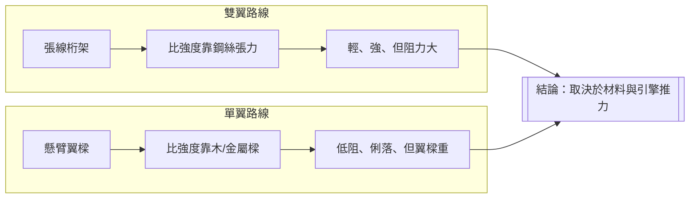

# 第 2 章 · 第 1 節 雙翼對單翼的聖戰：張線桁架與帆布的邏輯

## 兩種哲學

1903 年後，航空界分裂為兩大陣營。雙翼機（biplane）派以賴特兄弟為宗師：上下兩片機翼以支柱與張線（bracing wires）連成桁架（truss），像橋樑一樣用**拉、壓構件**分擔載荷，機翼因而可以做得極輕薄——木樑、帆布、鋼絲，重到極限就是輕到極限。單翼機（monoplane）派以法國的 Louis Blériot、巴西的 Alberto Santos-Dumont 為代表：機翼懸臂（cantilever）或半懸臂外伸，乾淨低阻，但必須用足夠粗壯的翼樑自己扛住彎矩。這不是審美之爭，而是**材料力學的兩條路線**。

## 比強度的算術

關鍵概念是**比強度**（strength-to-weight ratio）。張線鋼絲只受張力，鋼的比強度極高，細如琴弦即可承擔數百公斤——雙翼桁架等於把「橋」豎起來飛。問題是張線也產生大量阻力，且帆布翼面靠張力繃緊成薄膜，本身毫無抗彎能力，一旦張線鬆弛或斷裂，機翼立即失形。木製翼樑則受壓、受彎，雲杉（spruce）的比強度在天然材料中近乎頂尖，但尺寸受天然木材限制，無法任意加粗。單翼機要成立，要嘛等待更高比強度的金屬（如 1909 年問世的 duralumin 硬鋁），要嘛接受機翼粗重。

## 兩台樣本機

1906 年 11 月 12 日，Santos-Dumont 的 14-bis 箱形風箏式雙翼機在巴黎 Bagatelle 飛出 220 公尺，是歐洲首例受公證的動力飛行——雙翼路線在歐洲首開紀錄。但 1908–1909 年，Blériot 以 Blériot XI 半懸臂單翼機橫越英吉利海峽，證明單翼機不僅可行且更快更俐落。1910 年代法國 Deperdussin 競速單翼機一度刷新速度紀錄。

## 戲劇性的反覆

單翼派隨即遭逢重擊。1910 年前後法國 Antoinette 單翼機接連空中解體；1912 年，英國皇家飛行隊的 Bristol 單翼機（內裝法國 Gnome 旋缸引擎）連續失事，英國戰爭部（War Office）竟於 1912 年 9 月下令皇家飛行隊停飛所有單翼機——著名的「單翼禁令」。禁令表面上是安全考量，底層是結構應力計算能力不足：當時工程界對懸臂機翼的彎矩分佈、張線預緊力與疲勞缺乏可靠方法，失事無法診斷，只能整體封殺。雙翼機則因桁架冗餘度高、單構件失效不致命，成為軍方保守主義的必然選擇。

文化與經濟的力量同樣強大：雙翼機結構直觀，車庫工坊就能修補張線帆布，催生了遍地開花的飛行學校與特技表演業（barnstorming）；單翼機則需要更精密的製造與檢驗體系。一直到 1920 年代金屬懸臂翼技術成熟（如 Fokker F.VII、Ford Trimotor 的高翼桁架設計），1930 年代單翼機才全面取代雙翼機。這場聖戰的教訓是：**設計路線之爭，本質是材料與製造能力之爭**——工程師不能選擇自己喜歡的答案，只能選擇當代材料允許的答案。
