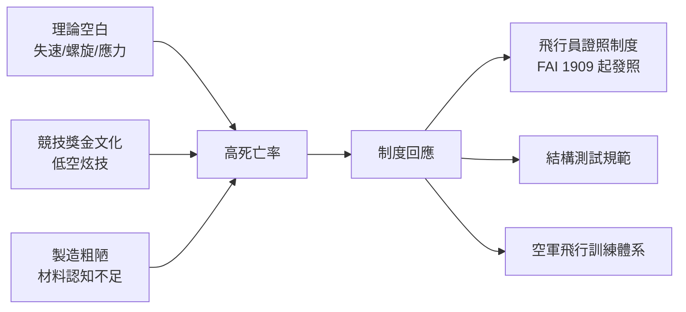

# 第 2 章 · 第 3 節 早期試飛的血性代價：1896–1914 的先驅墳場

## 以血為學費的年代

從 1896 年 Otto Lilienthal 在柏林附近的 Stölln 山丘墜機、翌日傷重不治（留下遺言「犧牲是必要的」/ Opfer müssen gebracht werden），到 1914 年一戰爆發，不到二十年間，世界級航空先驅的死亡率高得驚人：Lilienthal（1896）、英國的 Percy Pilcher（1899，滑翔墜亡）、巴西的 Augusto Severo（1902，飛艇爆炸）、美國的 Langley 試飛員 Charles Manly 僥倖生還、法國的 Ferdinand Ferber（1909）、英國的 Charles Rolls（1910，雙翼機空中解體）、美國的 Arch Hoxsey 與 John Moisant（1910–1911）、英國海軍史上第一位飛行員 Eugene Ely 之外的無數無名者。法國氣球員與飛行員的死傷名單更長——單是 1910 年一年，法國就有逾三十名飛行員喪生。

## 失速與螺旋：認知的黑洞

死亡的最大來源不是膽量不足，而是**理論空白**。當時工程界尚不理解**失速（stall）**：當攻角超過臨界值（一般約 15–18 度），機翼上表面氣流分離，升力驟降、阻力暴增。飛行員只知道「拉桿拉太滿會掉下去」，卻不知道臨界攻角是一堵看不見的牆。更致命的是**螺旋（spin）**：失速後若左右翼先後失速，飛機沿陡螺旋急墜，所需高度損失僅數百呎——早期飛機動輒在低空表演急轉彎，一旦進入螺旋幾乎必死。螺旋的物理機制要遲至 1912 年 F.W. Lanchester 的理論與一戰期間英國的系統性研究才逐漸釐清；能從螺旋改出的標準技術（鬆桿、反方向舵）在 1916 年前後才成為飛行教材。

結構應力的認識同樣粗糙。張線預緊力怎麼算、帆布濕透後重量變化多少、木材節疤如何削弱翼樑——全靠試誤。1910 年 Charles Rolls 的雙翼機在 Bournemouth 空中解體，正是尾翼結構失效的典型。

## 競技、金錢與保險

死亡人數之所以居高不下，還有經濟結構的原因。1910 年前後歐美掀起航空競賽熱：Reims（1909）、Belmont Park、Blackpool 等大賽的豐厚獎金吸引職業飛行員在觀眾面前表演急轉、俯衝、貼地掠過——風險直接兌換成門票與頭條。飛行學校以「教會飛行」收費，學員生命毫無保障。保險業則以驚人費率回應：1910 年代飛行員壽險保費是一般人的數倍，許多保單明文把航空列為除外責任，逼得飛行員組成互助會。

## 制度的回應

血的代價催生了現代航空安全體系。國際航空聯盟（FAI）自 1909 年開始發行飛行員執照（Blériot 執照第 1 號），把「會飛」變成可認證的資格；1910 年代初，法國、英國、德國陸續要求飛機出廠前做靜力載荷測試（如機翼加壓至設計載荷數倍不裂）；英國皇家飛行隊建立了事故調查與機型停飛制度。這些制度最初是軍方與保險公司的自保之舉，日後卻演化為現代民航的適航認證體系。

歷史的前後呼應耐人尋味：Lilienthal 的遺言「犧牲是必要的」成為一代人的墓誌銘，但真正讓死亡率下降的不是勇氣，而是**風洞數據、應力計算與飛行前檢查**——知識每前進一寸，墳場就縮小一分。早期試飛的悲壯，本質是一門工程科學在累積其「失敗數據庫」的代價。
