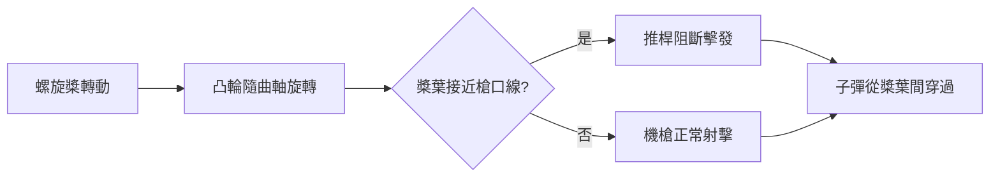

# 第 3 章 · 第 1 節 福克同步射擊器：把槍口對準螺旋槳

## Roland Garros 的權宜之計

一戰開打時，飛機只是偵察工具，飛行員彼此揮手致意。1915 年春，法國飛行員 Roland Garros 改變了一切：他在莫拉納-索尼耶（Morane-Saulnier）L 型單翼機的螺旋槳葉片根部加裝鋼製偏折楔（déflecteurs），讓機首固定式霍奇克斯機槍（Hotchkiss）射出的子彈，打到槳葉時被楔子彈偏。這是粗暴的權宜——約 7% 的子彈仍會反彈傷及槳葉與飛行員，且槳葉迅速疲勞。但「機首固定槍＋駕駛員直接瞄準」的殺傷力驚人：1915 年 4 月 1 日起短短兩週，Garros 擊落（或迫降）三架德機。

**1915 年 4 月 19 日**，Garros 因引擎故障迫降德佔區被俘，其偏折器被德方仔細研究。德國航空司令部下令各廠競標真正的「同步」方案。

## Stangensteuerung：機械的協奏

勝出者是荷蘭裔工程師 Anthony Fokker，其工廠位於德國什未林（Schwerin）。Fokker 團隊（ chief engineer 的方案常被歸於他本人，實際上團隊成員如 Heinrich Lübbe 參與甚深）在約 48 小時內整合出一套機械同步系統——德語稱 **Stangensteuerung**（推桿操縱）：凸輪裝在發動機曲軸或槳軸上，每當槳葉即將轉至槍口前，凸輪頂起推桿，**阻斷機槍的擊發**；槳葉一過，擊發恢復。射擊頻率與槳葉轉速嚴格鎖相，子彈只在槳葉之間的縫隙中穿過。

原理上是純機械的「事件同步」：曲軸轉一圈是週期 T，槳葉兩片（或三片）輪流通過槳面，同步器在每個危險相位產生一個「禁止窗口」。這需要極高的機械可靠性——任何凸輪磨損或連桿鬆動，下一秒就是把自己的螺旋槳打斷。德國士兵戲稱墜機現場為「飛行員自己射自己」。

## 福克災難

裝備同步射擊器的 Fokker E.I（單翼、傘式上翼、裝 7.92mm Parabellum 或後期施瓦茨洛澤機槍）於 1915 年夏投入西線。德國飛行員 Max Immelmann 與 Oswald Boelcke 各自擊落連連，成為首批「王牌」。從 1915 年夏到 1916 年初，德軍在空戰中取得近乎壟斷的優勢，協約國飛行員戲稱這段時期為**「福克災難」（Fokker Scourge）**——每日郵報的標題讓 Fokker 的名字進入英語詞彙。

## 前因後果

福克災難的深層意義在於**壟斷與資訊封鎖的軍事經濟學**：一項價值數週研發的機械技術，在封鎖的戰場上價值數百架飛機與制空權。協約國的反制不是等待，而是繞道——法國 Nieuport 11 採用上翼後置的張臂佈局，英國推動推進式（pusher）戰鬥機 Airco DH.2，把機槍移到無螺旋槳干擾的位置，1916 年春重奪優勢。德國則繼續精進同步技術，1916 年的 Albatros D 系列以雙聯同步機槍確立了「戰鬥機」的標準形態。

戰後的爭議同樣發人深省：Fokker 本人的回憶錄誇大其個人角色，荷蘭工程師與法國 Morane-Saulnier 的專利（實際上法國早在 1914 年就測試過液壓同步方案）長期被埋沒；Garros 本人於 1918 年 10 月 5 日——停戰前五週——被擊落陣亡。同步射擊器證明了一個殘酷的規律：**戰爭把一項純機械巧思，瞬間變成決定制空權的戰略資產**，而技術領先期往往只有幾個月。
