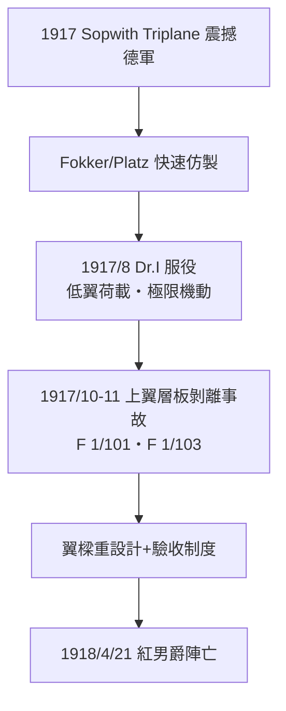

# 第 3 章 · 第 2 節 福克 Dr.I 與紅男爵：三翼機的極限機動與結構教訓

## 為何是三個翼

1917 年春，英國 Sopwith Triplane 在西線以卓越的爬升與盤旋性能震驚德軍——三翼佈局以更小的翼弦取得更大的總翼面積，**翼荷載（wing loading，重量÷翼面積）極低**，盤旋半徑小、爬升快。德國航空司令部急令各廠仿效。Anthony Fokker 的團隊（首席設計 Reinhold Platz 實際操刀）以現有 Fokker F.I 原型機為基礎，快速推出 Fokker Dr.I Dreidecker：三層等弦翼、上下翼間以支柱連成一體剛性桁架，全機無外張線，翼荷載極低，裝 110 匹 Oberursel UR.II 旋缸引擎（轉子式：曲軸固定、氣缸與螺旋槳一起轉），總重僅約 586 公斤。

旋缸引擎的物理特性塑造了 Dr.I 的性格：整個引擎作為旋轉質量產生巨大陀螺效應，機頭左轉快得驚人、右轉遲鈍——老練飛行員反而利用它做出右轉急墜再反轉的詭異機動。Dr.I 盤旋能力近乎無敵，但平飛速度慢（巡航僅約每小時 150 公里上下）、俯衝極限低，是典型的「格鬥特化」戰鬥機。

## 紅男爵

駕駛它的最著名者，是曼弗雷德・馮・里希特霍芬（Manfred von Richthofen），即「紅男爵」。這位普魯士貴族出身、原為騎兵軍官的飛行員，戰術上繼承了 Oswald Boelcke 的格言：從太陽方向俯衝偷襲、集中火力於單一目標、不打消耗戰。他於 1916 年底將座機下半部塗紅以利僚機識別，最終取得**80 次確認擊墜**，是一戰最高紀錄王牌，1917 年 6 月起指揮以血色塗裝聞名的第 1 戰鬥機聯隊「飛行馬戲團」（Jagdgeschwader 1）。

**1918 年 4 月 21 日**，Richthofen 率隊追擊加拿大飛行員 Wilfrid May 時，深入協約國陣地低空，於索姆河畔 Vaux-sur-Somme 上空被單發子彈擊中身亡，得年 25 歲。開槍者長期歸於澳籍機槍手 Ceci Popkin 或加籍飛行員 Roy Brown，至今仍有爭議；醫學分析多認為子彈自右下方穿入心臟區域，傷後他仍駕機滑降迫降，落地時人已垂死。

## 層板翼樑的災難

Dr.I 的光環下埋著結構危機。機翼翼樑採用高壓黏合的**層板（plywood）木料**，1917 年 10 月底至 11 月初，兩架 Dr.I（F 1/101 與 F 1/103，屬首批量產機）在飛行中**上翼折斷**墜毀，飛行員陣亡。調查發現：層板黏合層在潮濕環境下剝離（delamination），且翼樑木料品質參差——德國戰時材料短缺使工廠被迫使用未充分乾燥的木材。Fokker 被勒令全面改良：翼樑以品質受控的實心雲杉重新設計、加裝輔助翼肋支柱，並建立更嚴格的驗收測試。修改後的 Dr.I 事故率下降，但「三翼機脆弱」的名聲已定。

## 前因後果

Dr.I 的興衰是一則工程寓言：**極限機動性的代價是結構餘裕**。低翼荷載要求翼面大而翼樑輕，翼樑輕就必須依賴層板這種當時黏合工藝尚未成熟的複合材料——戰爭的時間壓力與材料短缺把測試週期壓縮到極限。這正是德國戰時工業的縮影：創意世界第一，但資源封鎖下，每一項突破都以可靠性為質押。

紅男爵的死同樣是時代轉折：協約國量產飛機（SPAD、Sopwith Camel）數量壓倒德國，王牌個人的技藝已無法對抗工業化的空戰。Dr.I 總產量僅 320 架，1918 年年中即退居二線；它留給後世的，是一個關於「設計極端化」與「材料科學進度」永恆張力的教訓——最亮眼的性能數字，往往寫在最薄的結構餘裕上。
