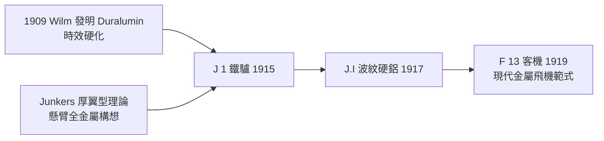

# 第 3 章 · 第 3 節 Junkers J 1 全金屬革命：波紋鋁板與硬鋁的誕生

## 帆布時代的異端

1915 年的航空界，機翼是帆布、機身是木框，整架飛機一半的生命靠張線的張力與布面的繃緊維持。就在這一年 12 月 12 日，德國德紹（Dessau），一位 56 歲的熱力學教授雨果・容克斯（Hugo Junkers）讓他的**J 1**（工廠代號 Blechesel，「鐵驢」）全金屬實驗機首飛成功——鋼管桁架機身、波紋薄鋼板製成的懸臂翼，全機無帆布、無張線。以當時的眼光，這台每小時僅 170 公里的笨重機器近乎笑話；以今日眼光，它是**所有現代金屬飛機的鼻祖**。

Junkers 的思想根基在學術界。他自 Aachen 任教起就堅信兩件事：其一，翼剖面應當是「厚」的——風洞數據顯示厚翼型升阻比優於當時流行的薄翼，且厚翼內部可以容納結構；其二，飛機應當是**懸臂式（cantilever）、全金屬、應力蒙皮**的整體結構，而非「木框＋帆布」的組合。1910 年他已為「全金屬懸臂飛翼」申請專利。

## 硬鋁：Wilm 的發明

全金屬構想的關鍵前提是金屬本身。1909 年，德國 Düren 金屬廠的冶金學家 Alfred Wilm 在做鋁合金淬火實驗時發現奇特的現象：含約 4% 銅的鋁合金淬火後並未立即硬化，反而在室溫放置數日後強度**持續上升**——這就是**時效硬化（age hardening）**，金屬內部析出細微強化相的擴散過程。此合金以 Düren 的郵政代碼 Düren（D）＋鋁（Al）＋Wilm 的 W 命名為 **Duralumin（硬鋁）**，抗拉強度接近軟鋼，密度卻只有鋼的三分之一。1909 年 Duralumin 上市，1911 年齊柏林飛艇率先採用。沒有 Wilm 的這一步，Junkers 的金屬飛機只是空想。

## 從 J 1 到 J.I

Junkers 的路線漸進推進。J 1 用波紋薄鋼板（因當時鋁板供應與加工受限）；1917 年的 **J.I**（對地攻擊機）改用**波紋硬鋁板（corrugated duralumin）**蒙皮——波紋（起皺）方向沿展向，讓薄板在不受力方向起皺、在受力方向保持剛性，巧妙解決「薄板抗彎能力差」的問題，這是**應力蒙皮思想**的原始形態。J.I 全重約 1,750 公斤，以 200 馬力 Benz Bz.IV 引擎飛行，防彈裝甲保護機組，1917–1918 年在低空對地任務中表現出驚人的抗損性——子彈打穿金屬蒙皮，飛機照飛。1919 年的 F 13 客機更確立了全金屬懸臂低單翼＋封閉座艙的現代民航範式。

## 制度與資源的背景

Junkers 的路線選擇與德國戰時處境深度綁定。英國海軍封鎖使德國木材（尤其是飛機翼樑所需的高級雲杉）日漸枯竭，而鋁土礦與電解鋁工業（拜耳法煉氧化鋁、Hall-Héroult 電解）在德國本土尚可支撐——**材料短缺反而加速了金屬飛機的研發**。德國軍方起初對笨重的 J 1 不置可否，但資源壓力使其逐漸改觀，1917 年起對金屬飛機給予政策支持。

帆布到金屬的革命，本質是**材料科學先行、結構理論隨後**的經典序列：Wilm 的冶金學意外（1909）→ Junkers 的結構哲學（1910–1915）→ 波紋蒙皮的實用化（1917）→ 1920 年代美國 Ford Trimotor 沿用波紋金屬，再到 1930 年代光滑應力蒙皮（Northrop Alpha、DC-3）——每一次躍遷，都建立在金屬比強度與疲勞知識的進步之上。Junkers 1935 年在納粹的迫害與財產剝奪下去世，但「全金屬懸臂翼」這一構想，如今仍是每一架飛機的基本骨架。
