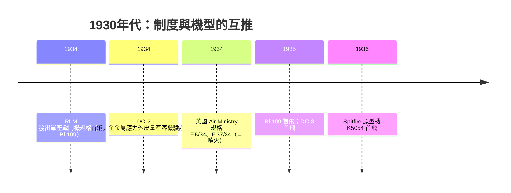

# 04.3　現代戰鬥機標準外形的誕生：1930 年代的五件套

## 到 1935 年，戰鬥機的「答案」被寫好了

如果時間停在 1930 年，戰鬥機的世界仍是雙翼機、開放座艙、固定起落架的世界。短短五年內，這個物種被徹底替換。到 1935–36 年，Spitfire 原型機 K5054 與 Bf 109 先後升空，**現代戰鬥機的全部外形要素已經就位**：全金屬應力外皮、懸臂單翼、可收放起落架、襟翼、密閉座艙。此後九十年，戰鬥機改的是心臟、感測器與外型細節，這副骨架再沒有動搖過。

## 五件技術，各自的前因

**1. 全金屬應力外皮**：源自容克斯（1915 J 1）、Rohrbach 與北美的發展（見 04.1），鋁合金 2014/2024 系與冷鉚工藝成熟後成為標準。DC-2（1934）率先證明它在量產客機上可行。

**2. 可收放起落架**：固定式起落架加整流罩的阻力可佔全機零升阻力的可觀比例。以阻力係數語言說，全機阻力 $D = \tfrac{1}{2}\rho V^2 S\, C_D$，其中 $C_D = C_{D0} + \dfrac{C_L^2}{\pi AR}$。固定起落架直接灌進 $C_{D0}$（零升阻力），而且是「隨速度平方懲罰」的那一項——速度越快，廢阻力越貴。收放機構早在 1910 年代就有人試過，但直到液壓／電動作動筒與高速巡航需求同時成熟，它才從玩具變成必需品。**收起起落架常可省下一成的 $C_{D0}$，在同等功率下直接換來數十公里的極速**。

**3. 襟翼**：後緣襟翼提高 $C_{L,max}$，讓高翼載的薄翼飛機能在可接受的速度起降。1920 年代 Fowler 襟翼（向後滑出並下偏，同時增面積與彎度）與簡單分裂襟翼先後問世。沒有襟翼，就沒有薄翼高速單翼機——這是 109 與 Spitfire 能敢用高翼載的隱形前提。

**4. 密閉座艙**：阻力小、高度適應性佳，但早期飛行員抗拒——「要聞到風才像飛行」。直到氧氣面罩與增壓技術、以及客機（如波音 247、DC 系列）證明密閉座艙的舒適與速度後，戰鬥機才跟進。109 與 K5054 原型機首飛時甚至仍用開放座艙，數年內全數改裝密閉罩——文化被性能收編。

**5. 懸臂單翼與薄翼**：張線與支柱的廢阻力被結構計算的進步（應力外皮、金屬桁條）取代。

## 兩套制度，兩種節奏

這場換代不是純技術事件，而是**制度事件**：

英國 **Air Ministry** 以「規格（Specification）」制度向業界招標——F.7/30 催生了平庸的 Gladiator 雙翼機，其接續規格 F.37/34 則讓 Supermarine Type 300 長成 Spitfire。德國 **RLM** 表面上是同一套招標邏輯，實際上綁定了重整軍備的政治時間表與鋁材、機床的資源分配。兩國制度殊途同歸：**規格寫下性能數字，性能數字逼出單翼、收放起落架與襟翼**。民間市場也在推——美國客機競爭（波音 247 vs DC 系列）逼出速度，軍方再從客機技術裡抄作業。

## 標準外形的經濟學

這套「五件套」之所以成為標準，是因為每一件都服務同一個變數：**在固定功率下降低阻力、提高可用的升力範圍**。阻力預算的重新分配，讓 1930 年末的戰鬥機從 300 km/h 躍升至 550–600 km/h。而當活塞引擎在二戰末期逼近它的物理天花板時（見 05.3），這副 1930 年代定型的身體，正好接住即將到來的噴射心臟——這是時代給工程師的巧合，也是應力外皮、襟翼與收放起落架的工程師們未曾預言卻亲手鋪好的跑道。

---

*參考脈絡：DC-2/DC-3、Bf 109（1935）、Spitfire K5054（1936.3.5 首飛）、Air Ministry 規格 F.7/30 與 F.37/34、RLM 1934 招標。*
