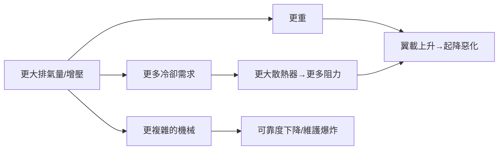

# 05.3　活塞引擎的物理天花板：700 公里之牆

## 速度的兩個敵人

二戰末期，最先進的活塞戰鬥機——P-51H、Spitfire F.Mk 24、Ta 152H、潑水者級的霍克海怒——極速都停在 **700–780 km/h** 一帶。這不是工程師不努力，而是兩堵物理牆同時逼近。

## 第一堵牆：螺旋槳與音速

螺旋槳是旋轉的翼。其槳尖在飛機前進速度 $V$ 之上，還疊加旋轉切向速度 $\Omega R$，合成速度為

$$V_{tip} = \sqrt{V^2 + (\Omega R)^2}$$

問題在於：飛機速度越高，要維持效率就必須讓槳葉在大槳距、高葉素迎角下工作，而**槳尖相對氣流的馬赫數** $M_{tip} = V_{tip}/a$ 一旦逼近 1，槳葉上出現局部超音速區與**激波**，阻力陡增（波阻）、升力分布崩壞、效率斷崖式下跌。活塞戰鬥機的螺旋槳在飛行馬赫 0.7 上下就開始受苦——**這意味著活塞飛機的全機速度上限被槳尖卡在音速的七成附近**，約 750–800 km/h 是硬邊界。葉形可以做寬葉尖、大後掠（如 P-51 的葉尖設計）爭取幾十公里，但改變不了量級。

## 第二堵牆：功率的代價越來越貴

要對抗阻力，功率得長——但活塞引擎每多一分功率都收「復利利息」：

典型例子：二級三速增壓、水甲醇噴注、渦輪增壓（P-47 的 GE 系統）把結構複雜度推到極限；Rolls-Royce 的 Griffon、Napier Sabre（H 型 24 缸，3,500 hp）是工藝的巔峰，也是**單位功率重量、維修工時與故障率同時惡化的巔峰**。冷卻是隱形殺手：液冷引擎功率越大，散熱器越大，而散熱器阻力（縱使有 Meredith 效應補償）在高馬赫數下越難回收。螺旋槳自身也變重、變複雜——四葉、對轉、變距機構層層加碼。

## 飛機為此付出的代價

活塞戰鬥機的進化尾聲呈現清晰的「病態」：Ta 152H 為了高空速度把翼展拉到 14.4 m；霍克海怒與 P-51H 已是「活塞技術的滿溢」——性能增益以操控性、地勤負擔與事故率為代價。航空史家一致的判語是：**1945 年的活塞戰鬥機，已把 1930 年代定型的空氣動力骨架（見 04.3）榨到理論極限**。速度的下一個量級，必須換一種推進哲學。

## 出口：不吸入空氣燃燒、而是直接噴出去

螺旋槳的本質是「把軸功轉成大質量低速氣流」，其推進效率在飛行速度逼近槳葉音速時崩潰。噴射發動機走相反的路：**小質量、高速度的尾噴流**，在高速飛行下反而佔優。推進效率的比較（推進效率 $\eta_p \approx \dfrac{2V}{V_j + V}$ 對噴射而言）說明：速度越高，噴射的劣勢越小、優勢越大。

而噴射的心臟——燃氣渦輪——其可行性早在 1930 年代就被兩位工程師獨立證明：英國的 **Frank Whittle**（1930 年專利，1937 年 4 月試車成功）與德國的 **Hans von Ohain**（He 178，1939 年 8 月首飛）。活塞時代的天花板是氣動與熱力學共同寫下的，而推翻它的鑰匙也早已在熱力學的另一頁裡：布雷頓循環（Brayton cycle）——燃氣渦輪不需要「往復」，它可以一秒鐘燃燒幾十公斤空氣，不停不歇。

於是歷史在 1944 年交棒：當 P-51 的工程師還在為最後 30 km/h 修形散熱器時，Me 262 已在德國上空以 870 km/h 掠過盟軍機群。螺旋槳的七百年（自達文奇的手稿算起）飛行史，被一堵牆終結——而那堵牆的名字，叫做音速。

---

*參考脈絡：槳尖馬赫數與激波、二級增壓／渦輪增壓／水甲醇噴注、Ta 152H、Griffon 與 Sabre、Whittle（1937 試車）與 von Ohain（He 178, 1939）。*
