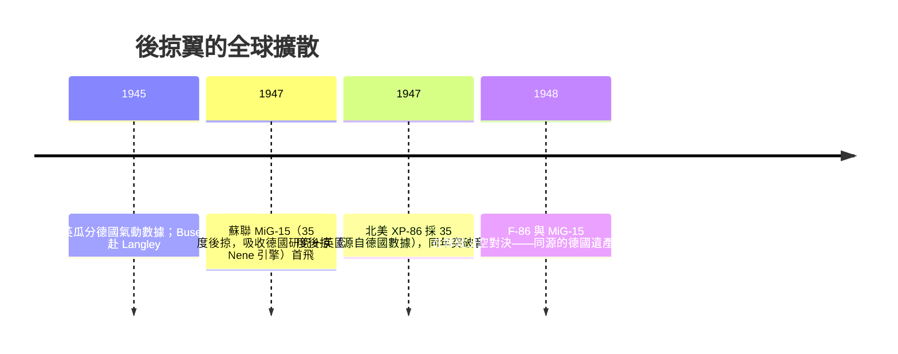

# 06.1　後掠翼的祕密資產：一場羅馬會議與被瓜分的風洞數據

## 1935 年的 Volta 大會：無人喝彩的先知

1935 年 9 月 30 日至 10 月 6 日，義大利皇家科學院在羅馬舉辦第五屆**伏特大會（Convegno Volta）**，主題「高速航空」——紀念伏特逝世一百週年的這場會議，如今被視為超音速空氣動力學的誕生地。與會者包括 Prandtl、von Kármán、Giuseppe Gabrielli 等一代宗師。

會上，一位 30 歲出頭的德國氣動學家 **Adolf Busemann**（哥廷根 Prandtl 學派出身）提出了一個驚世駭俗的方案：把機翼**向後傾斜**，讓機翼「感受」到的有效法向速度降到 $V \cos\Lambda$（$\Lambda$ 為後掠角），從而把臨界馬赫數推高——**用幾何換取壓縮性的寬容**。理論上，後掠可大幅延遲激波的出現，把跨音速阻力爬升的牆往後推。

反應是死寂。當年實用的飛行速度距音速尚遠，與會者禮貌地聽完，無人跟進。Busemann 後來自嘲，這個理論是「給未來的禮物」。唯一認真記下筆記的人之一，據說是來自美國的氣動學家（包括 John Stack 一系的 NACA 人士），但 NACA 當時也無意投入。

## 德國的祕密兌現

但德國內部聽懂了。1939 年後，Busemann 進入 **Braunschweig 的 LFA**（Luftfahrtforschungsanstalt），與 A. Betz 等人把後掠翼理論化（含「後掠翼的祕密資產」之原文概念：湍流度沿翼展受幾何影響的低壁面摩擦），與此同時 **Adlershof 的 DVL** 與 Messerschmitt 公司的風洞團隊做了系統的後掠翼測試。德國戰時的關鍵成果：

- 確認後掠可將阻力發散馬赫數 $M_{DD}$ 提升，並量化了後掠角與升力損失、副翼效率的關係；
- 發現**後掠引發翼尖失速與機頭上仰**等副作用，需用扭轉、翼刀（wing fence）等補救——翼刀正是 Me 262 與 MiG-15 上的小鐵片；
- Me 262 原本設計為直翼，因風洞數據顯示直翼在高速下有下俯與發散問題，後期版本機翼外段採用約 **18–19 度後掠**（主要是配平與重心補償的副產品，而非刻意的高速優化——這是歷史常被簡化的地方）；
- 1944–45 年的 P.1101、Ju 287（前掠實驗）與 Ta 183 等紙上計畫，把可變後掠、後掠戰鬥機的雛形都畫了出來。

## 戰敗之後：數據的瓜分

1945 年 4–5 月，盟軍技術情報部隊（美國的 CalTech／NACA 聯合團隊、英國的 RAE 團隊）湧入德國的研究設施。他們繳獲的不是機器，而是**十年份的高速風洞數據與理論報告**。美國以 Paperclip 計畫把 Busemann 本人帶到 NACA Langley；英國拿走部分報告；**蘇聯走的是另一條更徹味的路：把整座工廠與整批團隊連人帶圖紙搬回國**——包含徵用 Junkers、Siebel 等廠的德國工程師在蘇聯繼續研發（OKB-1 等），並把德國風洞技術內化到 TsAGI。

後果立竿見影：

歷史最諷刺的一幕在朝鮮半島上演：F-86 與 MiG-15，兩架都流淌著 1935 年羅馬會議與 1940 年代德國風洞血統的飛機，以同一個思想的孩子身份互相廝殺。Busemann 本人則在 Langley 待到 1962 年，晚年回到德國。他 1935 年那場無人喝彩的報告，最終成了整個噴射時代機翼的出發點——**思想的擴散，比飛機的量產更快，也更不受國界與戰勝戰敗的限制**。

---

*參考脈絡：Volta 大會（1935.10）、Busemann 後掠翼理論、LFA Braunschweig、Me 262 約 18–19 度外翼後掠、Operation Paperclip、蘇聯徵用德國團隊、F-86 vs MiG-15。*
