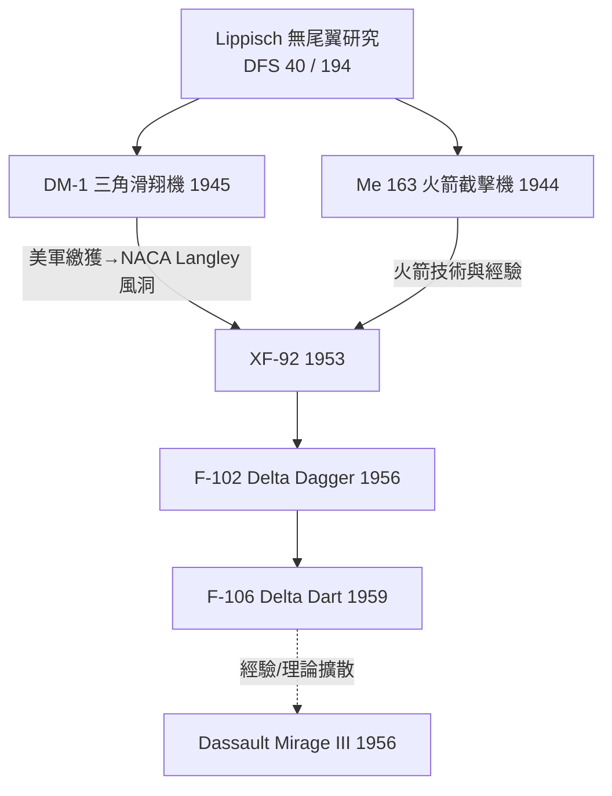

# 06.3　三角翼的火種散佈：李比希與被瓜分的未來

## 滑翔機俱樂部出來的異端

Alexander Lippisch（1894–1976）的航空教育不在大學，而在戰後德國的**滑翔機運動**——凡爾賽條約禁止德國擁有軍用航空，於是整個世代的德國氣動天才轉進無動力飛行，把滑翔運動變成了空氣動力學的地下研究所。Lippisch 從 1920 年代起執著於**無尾翼與三角翼**佈局：沒有水平尾翼，靠後掠的三角平面形上的升降副翼（elevon）同時俯仰與滾轉。

三角翼的氣動誘惑明確而深遠：

- **極大的後掠（可達 60 度以上）**把臨界馬赫數大幅推高，跨音速阻力爬升平緩；
- **大翼面積＋大容積**：內部空間大、結構重量相對輕（翼根弦長極長）；
- 代價同樣明確：低速升力係數低、起降速度高、配平與縱向阻尼惡化——**它天生是為高速而生、為低速而苦**的翼形。

## Me 163：火箭與三角的血統

1930 年代末，Lippisch 的 DFS 40／DFS 194 系列無尾研究機被 RLM 相中，發展為 **Me 163 Komet**——世界上唯一實戰過的火箭動力截擊機（1944 年投入）。它以 T-Stoff／C-Stoff 液體火箭推進，爬升率恐怖、極速近 **1,000 km/h**，成為第一架在平飛中**接近並超越 1,000 km/h** 的有人駕駛飛機（Me 163A V4，1941 年 10 月，Heini Dittmar，約 1,004 km/h）。但戰果寥寥：續航只有幾分鐘、燃料腐蝕性致命、降落滑橇把未燃燃料晃出的爆炸讓地勤與飛行員同樣恐懼。Me 163 的價值與 Me 262 一樣，在於**證明了極限，而非贏得戰爭**。

## DM-1：一隻被美軍發現的紙鳶

戰爭末期，Lippisch 團隊在 Prien am Chiemsee 造了一架全尺寸**三角翼滑翔驗證機 DM-1**——為超音速攔截機 P.13a 鋪路的低速操縱性試驗載具。它木造、粗糙、像一隻大號紙飛機。1945 年 5 月美軍抵達時，DM-1 原封不動躺在倉庫裡。

美國技術情報團隊（包括著名的康威爾前身 Consolidated-Vultee／Convair 的代表與 NACA 人員）一看見它就走不動了。DM-1 被原機運往美國，在 NACA Langley 風洞中做系統測試——**一架木造滑翔機，成了美國三角翼研究的起點標本**。

## Paperclip 與 Convair：F-102 血統

Operation Paperclip 帶走了 Lippisch 本人。他先在美國海軍顧問任上工作，隨後的技術影響沉澱進 Convair：其工程師 Ralph Schick 等人吸收德國三角翼數據，發展出 **XF-92**（1948 年設計、1948 年訂約，1953 年首飛的美國第一架三角翼噴射機）——它本身是 YF-92 攔截機驗證機的縮影，卻意外成為三角翼的搖籃。XF-92 直接衍生出：

F-102 的研發過程還附贈了氣動史上一段重要插曲：原型機因**面積律（area rule, Richard Whitcomb, 1952）**未被應用而過不了音速，改用蜂腰機身後破障成功——三角翼時代的工程師同時學會了跨音速面積律與後掠／三角佈局，兩項德國遺產與一項美國本土創見在同一架飛機上合流。

## Mirage：法國的獨立變異

三角翼血統的法國分支常被忽略。達梭的 **Mirage III**（1956 年 11 月首飛）以細長三角翼＋面積律蜂腰機身，達到 Mach 2.2 級，成為冷戰最暢銷的戰鬥機之一，賣往以色列、印度、澳洲等數十國。Mirage 的氣動基礎同樣可追溯到戰後法國吸收的德國研究（ONERA 對三角翼的分離渦升力理論貢獻卓著）。1967 年六日戰爭，以色列空軍的 Mirage III 一日之內幾乎殲滅阿拉伯聯軍空中力量——**一種 1940 年代德國戰敗工程的理論遺產，在 1967 年的中東沙漠裡決定了國家的存亡**。

## 思想比飛機長壽

Lippisch 1966 年回到德國，1970 年病逝。他親眼見到自己 1920 年代在滑翔機草圖上畫的三角形，長成 B-58 轟炸機、F-106、Concorde（細长三角翼／ogee wing 的遠親）與太空梭返回艙之前的所有升力體思想。三角翼的故事是航空史最清晰的隱喻之一：**工程知識不會隨著軍事失敗而消失，它只會隨著戰勝國的檔案袋、簽證與風洞重新發芽**。火種在戰敗國的手中點燃，卻在戰勝國的天空中燎原。

---

*參考脈絡：Me 163 Komet（1941.10 破 1,000 km/h）、DM-1 滑翔機、Operation Paperclip 與 Lippisch 赴美、XF-92（1953）→ F-102/F-106、Dassault Mirage III（1956）。*
