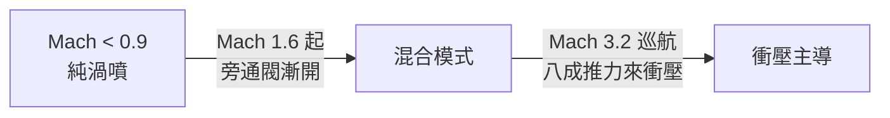

# 第 7 章 · 第 3 節 SR-71 黑鳥：用速度逃離飛彈

U-2 在 1960 年被蘇聯 SA-2 擊落的那一刻，全球偵察的規則被改寫：**高空不再保命，只剩速度**。CIA 與洛克希德 Skunk Works 的答覆是 OXCART 計畫——A-12，比 U-2 快四倍的鈦合金幽靈；空軍隨後在此基礎上追加雙座戰略偵察改型 SR-71，於 1964 年 12 月 22 日首飛。

## 鈦的政治經濟學

SR-71 的結構超過 85% 是鈦合金。但鈦的供應鏈成了冷戰的黑色喜劇：蘇聯正是世界最大鈦產國，洛克希德與中情局透過空殼公司（經第三方）悄悄向蘇聯購回原料——**用敵人的金屬，造飛得比敵人的飛彈還快的飛機**。

## 熱障：在 Mach 3.2 上「漏油」的飛機

以 Mach 3.2 巡航時，氣動加熱把機體蒙皮推向 200-300 °C 以上，比鋁合金熔點的一半還高。鈦在高溫膨脹劇烈，Skunk Works 的解法是工程上近乎反直覺的：**蒙皮板片之間故意留縫隙，讓金屬在高空高溫中「膨脹閉合」**。於是地面溫度下這些縫隙是開的——燃油從縫隙滲出，SR-71 以「落地後地上一片油漬」聞名。標準的接合間隙在常溫下就是漏油源，只有巡航加熱後才嚴絲合縫。燃油就充當唯一的巨大冷卻系統（heat sink），同時吸收熱量並為 J58 引擎預熱。

## J58：能在衝壓模式呼吸的渦輪機

Pratt & Whitney J58 是史上最怪異的量產推進系統之一。低速時它是普通渦輪噴射；接近 Mach 3 時，**六根旁通管把壓縮器第四級的空氣直接甩進加力燃燒室**，渦輪成了半個閒人，推力主要來自衝壓效應與加力混合—— turbo-ramjet 復合循環。進氣口的可動錐體（spike）隨 Mach 數後縮，把斜震波系「收」進進氣喉道，讓壓縮機避免吞入超音速氣流。整套機制靠感測器與自動控制運作——1960 年代最早的混合式自動控制之一。

## 服役史與落幕

A-12 自 1962 年首飛、1968 年退役（被雙座的 SR-71 取代與經費所限）；SR-71 自 1966 年進入戰備，飛過北越、中東、朝鮮半島上空，**從未被飛彈擊落**——被 SA-2 鎖定時，標準反應是「加速」。1990 年退役（1995-98 曾短暫復役），名為預算，實為衛星與無人機（後來的 RQ-170、全球鷹）時代的到來。

黑鳥留下的教訓：**最極端的工程成就，也敵不過衛星軌道與預算表的經濟學。**
