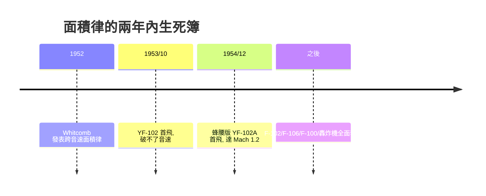

# 第 8 章 · 第 3 節 面積律的可樂瓶：惠特科姆的蜂腰革命

## 波阻從哪裡來

1950 年代初，戰鬥機衝向音速時集體撞牆：明明引擎推力足夠，速度卻在 Mach 1 附近被一堵看不見的牆頂住。物理原因在於跨音速時機身上處處出現局部激波，激波阻力 $\Delta D \propto (\Delta v/v)^2$ 隨局部超音速區擴大而暴增。德國學者早已知道機身本身會產生波阻，但沒有人把**機翼與機身當成一個整體**來看待。

## 一支可樂瓶的直覺

**理查・惠特科姆（Richard T. Whitcomb, 1921–2009）**，NACA 蘭利研究中心的年輕氣動學者，坐在黑色風洞觀察室裡盯著煙流，忽然意識到：激波「感受」的不是機身截面，也不是機翼截面，而是**沿縱向每個切面上飛機的總截面積**。若總截面積沿機身軸線的分布不平滑——例如機翼所在處截面突然隆起——就會在跨音速產生強激波。解法違反直覺：**在機翼安裝處把機身向內掐瘦**，讓總截面積分布趨近光滑曲線。掐腰的戰鬥機側看像一只可樂瓶，史稱**蜂腰（coke-bottle waist）**，學名**跨音速面積律（transonic area rule）**，1952 年惠特科姆發表。用數學說，設計目標是使

$$A(x) = A_{\text{機身}}(x) + A_{\text{機翼}}(x)$$

沿 $x$ 盡可能平滑，以壓低零升波阻峰值。

## YF-102 的死亡與 F-102 的重生

面積律登場之前，康維爾（Convair）的 YF-102 攔截機已按「漂亮圓筒機身」造好。1953 年 10 月首飛後，這架飛機死活衝不過音速——風洞與飛行數據都顯示波阻峰值太高。康維爾幾乎為此丟掉整個計畫。此時 NACA 把惠特科姆的新理論送到案頭，康維爾咬牙照辦：**把 YF-102 機身中段掐出蜂腰，機尾收束**，改出的 YF-102A 於 1954 年 12 月首飛，輕鬆突破 Mach 1.2。一架被判死刑的飛機靠一段理論救活——這是航空史上「理論直接救計畫」最著名的案例。

## 從蜂腰到超音速面積律

面積律隨即成為全世界的設計通則：F-100、F-105、F-106、B-58 的機身輪廓都有可樂瓶的影子；連波音 747 的駝峰機頭，也意外地在跨音速吃了面積律的紅利。惠特科姆本人並未停手：1960 年代他又提出**超音速面積律**（以馬赫錐切面取代垂直切面）與**超臨界翼型**（1970 年代，延後激波發生、讓客機能以高次音速省油），晚年再以翼梢小翼收官。一人三項改寫全行業的貢獻，NACA／NASA 歷史上無出其右。

## 觀點：形狀是被「算」出來的

面積律的深遠意義在於思想方法的轉變：飛機的外形從此不再由「機身是機身、機翼是機翼」的分件邏輯決定，而是由整機的氣動數學決定。冷戰軍備競賽提供了風洞與飛行數據的飢渴需求，NACA 的公共研究制度提供了理論誕生的土壤，而 YF-102 的瀕死則提供了理論立刻被採信的壓力。科技、制度與經濟三股力，在 1952 年的那個風洞裡擰成了一個可樂瓶。
