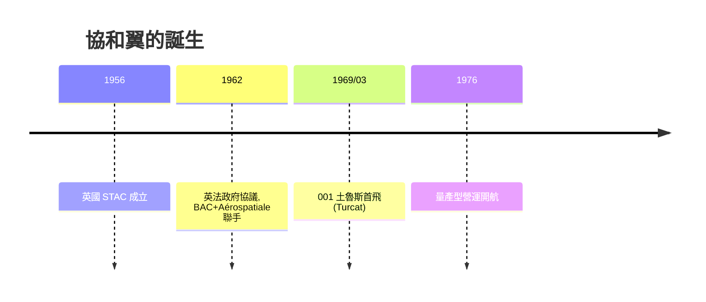

# 第 9 章 · 第 1 節 協和號的 ogee 三角翼：一曲雙贏的渦流

## 英法為何要一起造超音速客機

1956 年，英國成立超音速運輸機委員會（STAC），評估「載客 100 人以上、Mach 2 級」的客機是否可行；法國 Sud Aviation 同期也在研究「Super-Caravelle」。兩國各自發現：這種飛機研發費用以當時幣值高達上億英鎊級，任何一國財政都難獨扛，而美國波音、道格拉斯若也投入，將直接統治天空。於是 1962 年 11 月，英國與法國政府簽署條約級協議，由 **Sud Aviation（後併入 Aérospatiale）**與 **BAC** 聯合開發——「Concorde」這個名字本身就是「和諧」的英法雙語同字。這是史上第一次由兩個主權國家以政府條約形式共同造一架民航機：政治意志先於商業計算，也被政治意志綁架了退出的可能。

## 氣動難題：一台機翼要伺候兩個主人

Mach 2 巡航要求薄而後掠的機翼以壓低波阻；但協和必須在普通機場起降，此時它是一架沒有引擎推力餘裕的巨機，需要**低速時極大的升力係數**。直翼客機靠前緣縫翼與後緣襟翼增升，但那些機構會破壞薄翼的氣動外形並妨礙高速。三角翼提供了線索：大攻角時，前緣會捲起兩道穩定的**前緣渦**，貼附在翼面上方，產生額外的**渦升力（vortex lift）**——升力係數隨攻角增加不降反升，失速溫和。問題是：直邊大三角翼（如幻象三式）低速大攻角時阻力巨大、機頭必須抬到近乎「望天」的角度才能進近，飛行員視線全無。

## ogee：S 形前緣的妥協藝術

協和的答案是**ogee 雙三角翼**——前緣呈 S 形（希臘 ogee 曲線）：內段後掠極陡（約 80 度），外段後掠較緩。低速大攻角時，內段尖銳前緣穩定地拖出兩條強渦，向外段延伸並增強，渦升力把整架飛機「吸」在空中；高速時，外段後掠配合細長機身，波阻被壓到可接受。英國皇家航空研究院（RAE）與法國 ONERA 在風洞中多年迭代，並以 HP 115 與 BAC 221 兩架試驗滑翔機實際驗證大攻角渦流特性。ogee 翼讓協和得以用 Mach 2 的翅膀在 165 節進近——**渦升力是歐洲工程師用曲線寫下的商業談判籌碼**。

$$C_L = C_{L,\text{線性}} + k\,\alpha^2 \quad (\text{渦升力的平方項貢獻})$$

## 試飛與政治工程

1969 年 3 月 2 日，法國原型機 001 自土魯斯首飛，機長**安德烈・圖爾卡（André Turcat）**——他之前駕駛 Nord 1500 Griffon 火箭衝壓試驗機，是法國試飛員的傳奇；英國原型 002 於 4 月 9 日自菲爾頓首飛。Turcat 後來領銜完成型別認證，並在 1976 年以 Aérospatiale 試飛總監身分見證協和開航。工程上兩國分工精確到零件：機身一段英製、一段法製，任何一方中途退出都要賠償對方全部研發費——**條約設計本身就是防止政治跳船的結構**。

協和 ogee 翼證明了一件事：當政治承諾不可逆時，工程師的職責是把「不可能」磨成「勉強可行」的曲線——哪怕這條曲線要靠兩條看不見的渦流撐起。
