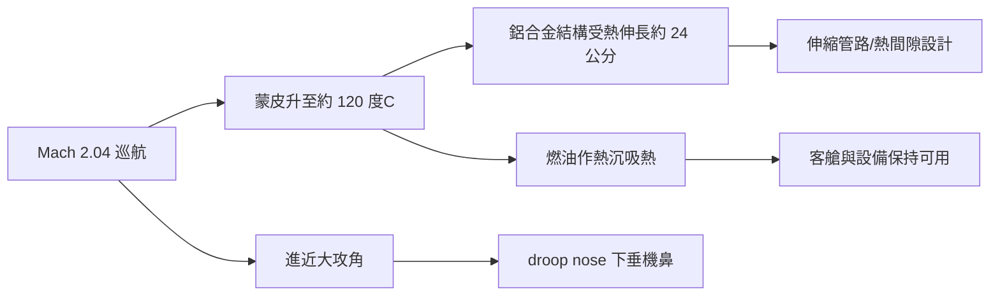

# 第 9 章 · 第 2 節 協和二馬赫熱障：機身變長的黃金客機

## Mach 2.04：速度是算出來的妥協

協和號巡航速度定在 **Mach 2.04**，不是逞強，而是材料經濟學的精確落點。機頭滯止溫度大致為

$$T_{stag} = T_0\left(1 + \frac{\gamma-1}{2}M^2\right)$$

在 18,000 公尺（$T_0 \approx -56.5\,^\circ$C）、$\gamma = 1.4$ 時，$M = 2.04$ 對應約 $120\,^\circ$C 的機頭長期受熱。鋁合金 DTD 5070（2014 系）經熱處理後仍保有結構強度的極限大致在 120–130 °C 量級——再快一點，就必須換鈦或不鏽鋼；換鈦則加工成本與當年鈦價會把整個計畫推向死地。英法團隊反過來算：**先選材料（鋁），再讓速度就範**。Mach 2.04 於是被寫進規格書。這是航空史上少見的「材料定速度」案例。

## 會呼吸的金屬：受熱伸長

巡航兩小時，機身被太陽般的滯止熱烤透，鋁殼平均溫升使整機縱向膨脹約 **20–30 公分量級**（常引約 24 公分）。工程師的應對滲透到每個細節：燃油管路用可伸縮的波紋段與滑動接頭；艙門與門框留熱態間隙；客艙隔板刻意與蒙皮脫開，讓乘客腳下走道在熱脹後仍不拱起。最詩意的證據是地勤的觀察：**巡航時機身確實變長，降落冷卻後又縮回去**——協和是一架會呼吸的飛機。

## 燃油兼作散熱器

超音速巡航的持續問題是：哪裡有無限的冷源？協和的答案是把**燃油當熱沉（heat sink）**：引擎滑油、液壓油、空調系統的熱量先傳給即將燒掉的燃油，燃油再進入燃燒室把熱量「丟棄」。加上蒙皮主動排布的隔熱與通風設計，機艙內乘客面前的內壁溫度被壓在溫暖而不燙手的程度。窗戶小如郵票、客艙窄如地鐵——超音速豪華客機的奢華，是每平方公寸都在跟熱力學談判。

## droop nose：因為看不見跑道

ogee 翼的代價是起降必須大攻角：進近時機頭仰起，擋風玻璃後的飛行員看見的是天空而非跑道。協和的解法是**可下垂機鼻（droop nose）**：巡航時機鼻流線封閉以保氣動光潔；起降時液壓把整段機鼻下折 5 度（或再開遮罩至 12.5 度），讓駕駛員重見跑道。這套結構增加了重量、複雜度與維修成本，卻是渦升力氣動學交給結構工程師的必答題。

## 規格的哲學

協和教會後世設計者一件事：規格書上每個數字都是科技、經濟與材料的聯合判決。Mach 2.04 不是巔峰，而是鋁合金的臨界點；24 公分不是瑕疵，而是把熱脹冷縮納入日常維護制度的證據。當工程師不再對抗物理、而是與它簽約，極端設計才得以營運二十七年。
