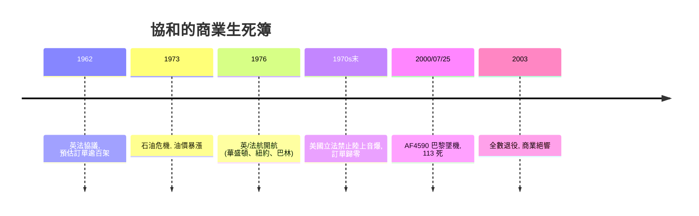
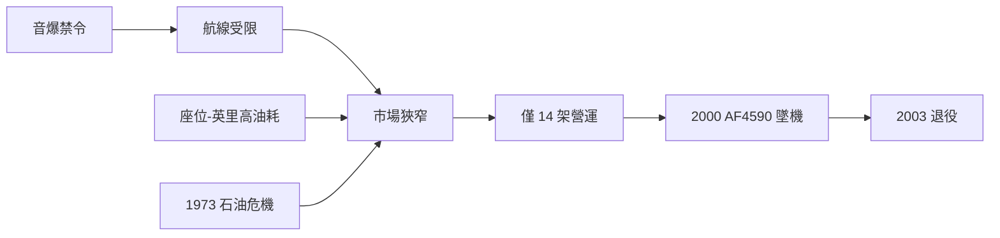

# 第 9 章 · 第 3 節 音爆限制與商業絕響：環境法規殺死的天之驕子

## 音爆：地面上的一百萬次投訴

超音速飛機的激波觸地時，地面聽到的是兩聲連成一體的巨響（N 形波），可達 130 分貝以上，足以震裂窗戶、驚擾牲畜。1950 年代美國試圖讓民航「習慣」音爆：奧克拉荷馬市的例行超音速飛行試驗換來上萬件投訴與建物索賠——這場社會實驗宣判了音爆的死刑：**這不是工程問題，是社會契約問題**。各國隨後禁止在陸地上空進行非軍事超音速飛行。協和的航線被這條法規劈成兩半：跨大西洋（多在海上）可行；跨太平洋與橫貫大陸（最肥的市場）不可行。一架 Mach 2 飛機，被迫只服務少數幾條越洋航線。

## 經濟學的緊箍咒：座位-英里

協和僅載約 100–128 位乘客，卻燒掉波音 747 級的燃油（每小時逾 17 噸級）。以**每座位-英里油耗**計，協和約為次音速客機的 6–8 倍。它的商業模式只能靠「用 3.5 小時換 5,000 美元級票價」的超高端市場——金融家、政要、明星。1973 年**石油危機**爆發，油價翻數倍，協和的單位成本結構被打穿；1970 年代中後期波音 747 大幅降低跨洋票價，把中產乘客全數吸走。原訂上百架的訂單（泛美、環球、西北等）相繼取消，最終僅 14 架投入營運，買家只有英航與法航——**兩家國營旗艦航空，賠本也要飛的國家形象工程**。

## 2000 年 7 月 25 日：AF4590

法航 4590 班機自巴黎戴高樂機場起飛，機輾過前一架 DC-10 留下的金屬條，輪胎爆裂碎片擊穿左翼油箱，燃油外洩被引擎高溫引燃，起飛後約兩分鐘墜入戈內斯鎮旅館——機上 109 人與地面 4 人罹難。調查揭示了設計的脆弱面：機輪碎片與油箱防護在認證時代未被視為設計條件。此後協和加裝凱夫勒油箱內襯、強化輪胎，2001 年復飛——但 911 之後高端客運需求崩落、機齡逼近 30 年、維修成本失控。2003 年 4 月，英航與法航宣布退役；10 月 24 日，最後一班商業航班落地希斯洛，協和時代落幕。

## 教訓：環境與經濟也是設計變數

協和從未「技術失敗」——它精準達成規格並安全營運了二十七年（事故歸因於外物，非機型固有缺陷）。它敗在三個圖紙之外的變數上：

1. **環境法規**：音爆把可飛航線裁掉大半——法規等於航線，航線等於市場。
2. **能源經濟**：石油危機把座位-英里成本變成不可談判的紅線。
3. **制度慣性**：國家榮譽綁架了退場時機，賠本營運拖延了二十餘年。

後世的超音速客機計畫（從 Overture 到各新創）第一條設計準則都是「低音爆或無音爆」——協和沒有輸給物理，它輸給了地面上的世界。**設計者的課題因此擴大：飛機的形狀由空氣動力學決定，飛機的命運由環境法規與經濟學決定。**
