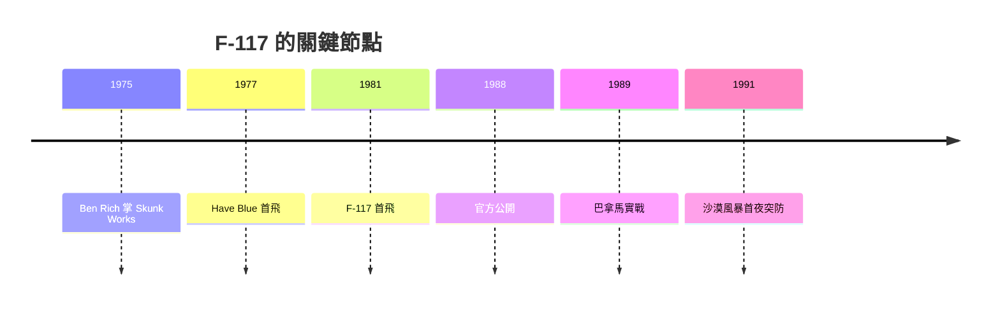

# 第 10 章 · 第 2 節 F-117 夜鷹的分面幾何：把飛機摺成數學

1975 年，班・里奇（Ben Rich）接掌洛克希德傳奇的「臭鼬工廠」（Skunk Works）。兩年後，一架形似摺紙、毫無氣動優雅可言的黑色小飛機升空——Have Blue 驗證機。它的設計座右銘帶著工程師式的自嘲：有人叫它「絕望鑽石」（Hopeless Diamond），因為那塊稜稜角角的模型在風洞報告裡看起來根本飛不起來，卻在雷達房裡幾乎不存在。

## 為什麼是「折面」而不是曲面？

烏菲姆切夫的邊緣波方法可以計算平板與邊緣的散射，但 1970 年代的電腦無力求解複雜曲面上的電磁場積分。工程師丹尼斯・奧弗霍爾澤（Denys Overholser）因此採取一個天才的化繁為簡策略：**把整架飛機全部用平面拼成**。每個平面對雷達的鏡面散射方向可以用簡單幾何算出；只要把這些平面安排得讓散射能量集中射向天空與地面、絕不平行彈回來波方向，再加上邊緣繞射的控制，整機的雷達截面（RCS）就能壓到鳥類以下的水準。折面幾何（faceting）不是美學選擇，而是**計算能力的妥協**——電腦只能解平面，飛機就長成平面。

代價極其慘烈。Have Blue 的升阻比糟糕、操縱性怪異，兩架驗證機先後在 1978、1979 年墜毀。但雷達試驗的數據石破天驚，美國空軍於 1978 年正式啟動生產型計畫。

## 從機密到戰場

1981 年 6 月，F-117 首飛。此後近十年，它在內華達沙漠的托諾帕基地夜航，外界只見傳聞。1988 年 11 月，五角大廈終於公布一張糊到看不清的官方照片；1989 年 12 月，F-117 在入侵巴拿馬的「正義事業行動」中首次實戰使用。而真正的加冕禮在 1991 年 1 月 17 日：沙漠風暴行動首夜，F-117 機群穿過伊拉克號稱世界密度最高的防空網，直搗巴格達市中心，且整場戰爭中無一被擊落。防空雷達在它面前近乎失明——折面幾何用難看的空氣動力學，買回了戰場上的絕對先手。

## 制度與文化的驅動

F-117 的成功是一部「制度工程」史：DARPA 提供高風險資助、空軍以嚴格保密換取跳過繁文縟節的研發速度、臭鼬工廠的小團隊文化則保護了「醜飛機」不被傳統氣動委員會扼殺。計算機的侷限決定了形狀，形狀決定了戰術（只能夜間出擊），戰術又重塑了空軍對「制空權」的定義。1990 年代後期，超級計算使曲面隱形成為可能，F-117 這隻「醜小鴨」於 2008 年除役——但由它開啟的隱形時代，至今仍在延續。
