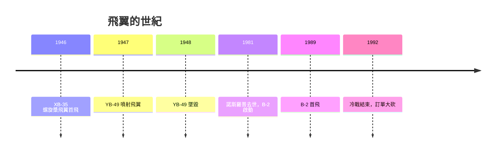

# 第 10 章 · 第 3 節 B-2 與飛翼線傳控制：北羅普的遺願成真

## 飛翼的悲劇先聲

1940 年代，傑克・諾斯羅普（Jack Northrop）傾盡心力投入純飛翼（flying wing）轟炸機 XB-35、噴射動力的 YB-49。飛翼取消機身與尾翼，結構效率與氣動乾淨度近乎理想，卻撞上一堵物理高牆：**縱向靜不穩定**。沒有尾翼提供回復力矩，飛翼天生不安分——遇上擾動，姿態只會越飄越遠。1940 年代的液壓機械操縱與人工反應速度，根本追不上不穩定氣動的發散速率。1948 年 6 月，一架 YB-49 在飛行測試中失事墜毀，機組全數罹難。1950 年代計畫被取消，諾斯羅普晚年親眼看著自己的夢想被拆毀。1981 年臨終前，他收下了一份遲來的禮物：一枚國家航空航天勳章，以及 B-2 計畫的一張機密照片——他的飛翼，將以另一個時代的名義重生。

## 數位飛控改寫物理

讓飛翼可行的不是氣動學的突破，而是**控制論的突破**。1980 年代，數位線傳飛控（fly-by-wire）加上飛行電腦的增穩系統，可以在飛行員毫無察覺的情況下，每秒數十次偵測姿態偏差並自動修正舵面，把一架天生靜不穩定的飛翼「偽裝」成溫馴的飛機。人類駕駛員控制「虛擬的穩定飛機」，電腦控制真實的不穩定機體——這正是 F-117 用同樣技術解決的問題，B-2 只是把它推到極致。

1989 年 7 月 17 日，B-2 幽靈轟炸機首飛。鋸齒狀的邊緣與逐段改變角度的翼緣，讓雷達散射能量沿預定方向散射；機體大量採用雷達吸波材料（RAM）與吸波結構；進氣口隱藏於背上，遮蔽發動機風扇葉片這一雷達強反射體。它的 RCS 據公開報導壓到極低量級，使轟炸機能單機滲透防空網。

## 經濟與政治：一億美元級的噩夢

B-2 的成本成為政治問題：若將研發費用攤入，單價高達約 20 億美元（2010 年代經通膨重估的每架全壽命成本更高），是史上最貴的飛機。1987 年空軍原訂 132 架；1991 年蘇聯解體，B-2 賴以存在的威脅瞬間消失，國會在裁軍浪潮中將訂單砍至 21 架。冷戰的科技競賽既催生了它，其終結又閹割了它——**技術的敵人不是技術，而是地緣政治的轉向**。B-2 至今仍在役，而諾斯羅普的飛翼美學，則在 B-21 上得到第三代傳承。一個 1940 年代的夢，靠 1980 年代的電腦，在 2020 年代繼續飛行。
