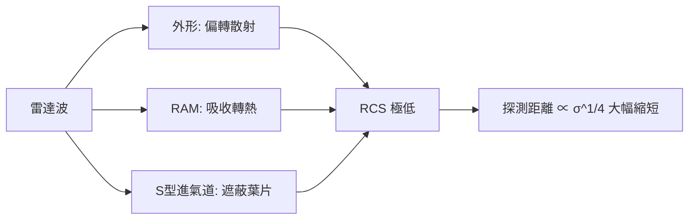

# 第 11 章 · 第 2 節 隱形三大屏壁：雷達截面的極致壓制

## 雷達距離的四次方根定律

要理解隱形，先要理解雷達的軟肋。雷達方程給出最大探測距離與目標雷達截面（RCS，記作 $\sigma$）的關係：

$$R_{max} \propto \sigma^{1/4}$$

這個四次方根是隱形工程的聖杯：**把 RCS 縮小一萬倍，探測距離只縮短為十分之一**。換句話說，飛機不必「消失」，只要把被發現的距離壓縮到防禦體系反應不及的範圍之內，隱形就轉化為戰術勝利。$\sigma$ 的物理意義是目標散射回雷達的功率與入射功率密度的比值面積——它與實際尺寸無必然關係，一枚平板在特定角度的 $\sigma$ 可以遠大於其幾何面積。壓制 $\sigma$ 的戰役，於是沿著三條屏壁展開。

## 第一屏壁：外形散射控制

最強的回波來自鏡面反射與角落結構。設計者的武器是幾何：讓機體表面近乎處處平行或斜置，把散射能量集中到少數幾個預定的「閃爍方向」，避開雷達可能出現的方位（F-117 與 B-2 的稜線即為此設計）；進氣道遮蔽葉片、天線藏入蒙皮、艙門鋸齒化。外形控制是「被動且免維護」的一層，效果最大，但必須在圖紙階段就定案。

## 第二屏壁：吸波材料（RAM）

塗層與結構型吸波材料以磁性損耗（如羰基鐵粉）或電阻性損耗，將入射電磁能轉為熱能，並以干涉原理讓表面反射與底層反射相消。RAM 能「滅火」於外形無法處理的殘餘散射，但代價高昂：增加重量、每飛行小時耗費大量維護工時、且對不同波段效果不同。F-22 與 F-35 在材料一體化與可維護性上較前代有長足進步（此為一般公認的方向，具體性能數據屬機密，宜保守表述）。

## 第三屏壁：遮蔽與內埋

發動機風扇葉片是雷達的強反射體，S 型進氣道讓雷達波在彎曲管道內多次反射衰減、無法「看到」葉片；武器從外掛改為內部彈艙，消除了飛彈與掛架這些外掛時代最大的散射源——外掛一枚飛彈足以讓隱形飛機在雷達上「現形」。

## F-22 與 F-35 的取捨

同為第五代，F-22 以制空為唯一使命，追求極致隱形與超巡；F-35 則是對地、多感測器融合的多用途機，在隱形與載荷、成本、可維護性之間做了不同的妥協。兩者孰優，取決於任務情境而非單一數值。隱形從未是「隱身斗篷」，而是一場關於四次方根、幾何與材料的精密會計——每一分 dB 的下降，都是工程師在物理允許邊界上，用制度、資金與創意換來的。
