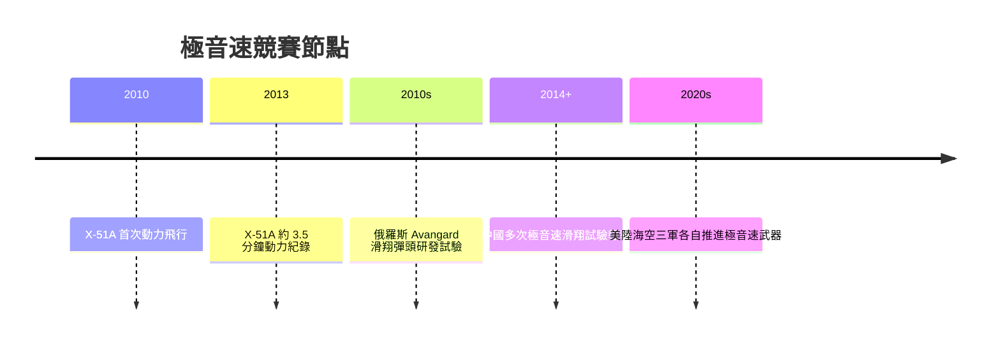

# 第 12 章 · 第 1 節 乘波體極音速：騎在激波上的飛行

## Mach 5 的物理牢籠

五倍音速之上，航空學換了一副面孔：空氣在激波後溫度可達數千度，氮氧分子開始離解，熱不再只是工程問題，而是化學問題。更根本的困境是升阻比——傳統構型在極音速下的波阻會把 $L/D$ 壓得極低，飛不了多遠。乘波體（waverider）是對此的優雅回答：先設計一個已知的激波流場（如楔形或錐形繞流），再把飛行器「雕刻」成恰好**騎在自己激波的頂上**，前緣處處與激波相切。激波像一件看不見的雪橇板，把高壓氣流兜在機腹下方，既不讓高壓側漏到上表面，也就獲得遠高於傳統構型的升阻比。其理論可追溯至 1950 年代 Nonweiler 的「倒 V 型」構想，此後錐形導流（cone-derived）設計成為主流。

## 超燃衝壓：在超音速中燃燒

乘波體需要動力，而極音速下渦輪與傳統衝壓皆告失效。超燃衝壓發動機（scramjet）讓氣流以**超音速**通過燃燒室——燃料必須在千分之幾秒、氣流比子彈還快的環境裡完成混合與燃燒，如同「在颶風中點燃火柴」。美國的 X-51A「乘波者」驗證機在 2010 至 2013 年間進行多次飛行試驗，屢遭失敗：2010 年成功但未達計畫目標，2011 年進氣道未能啟動，2012 年控制舵失效提前落海。2013 年 5 月的第五次試飛終於成功：由 B-52 空中投放、固態助推器加速後，超燃衝壓點火，動力飛行約 3.5 分鐘、速度逾 Mach 5，創下當時吸氣式動力極音速飛行的最長紀錄。每一次「多燒一分鐘」，都是燃燒學與熱防護十年功力。

## 熱防護：極音速的真名

極音速載具的成敗在最外層。鈍頭體以激波升溫換取熱流降低（太空梭的哲學），但乘波體為保升阻比必須用**銳利前緣**，熱流因此集中於刀刃之上——碳-碳複材、陶瓷基複材與主動冷卻成為必修課。這正是滑翔載具的難題所在。

## 軍備競賽的回潮

2010 年代，極音速滑翔載具（HGV）成為大國競賽新焦點：俄羅斯宣布的 Avangard 滑翔彈頭宣稱可機動突防飛彈防禦；中國也進行了多次滑翔飛行試驗；美國則以陸、海、空軍多線並進。HGV 在高層大氣以非彈道軌跡機動，壓縮防禦方的預警與攔截窗口——其威懾意義不在速度本身，而在**不可預測性**。冷戰式的「速度競賽」以新形式重演，而乘波體設計、scramjet 燃燒與 TPS 材料，正是這場競賽的三門必修學分。設計師的圖板上，氣動學再次回到物理的最前線。
