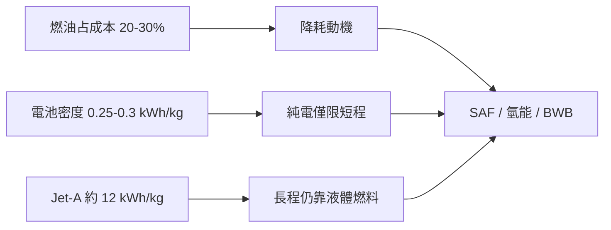

# 第 12 章 · 第 2 節 綠色航空與混合翼身：能量密度的硬約束

## 一道無法繞過的物理題

航空脫碳的一切難題，都藏在一個數字對比裡：Jet-A 煤油的能量密度約 12,000 Wh/kg，而今日鋰電池約 250–300 Wh/kg——**差距近四十倍**。航空是少數無法「隨時停車充電」的運輸方式，每一公斤電池在起飛時都是純負擔。這道硬約束決定了綠色航空的階梯：先短程、後長程；先混合、後純電。

## 經濟的推手：燃油即命脈

燃料約占航空公司營運成本的兩至三成（油價高漲時更甚），因此每降低 1% 燃耗，都是整個產業的利潤線。這是「綠色航空」最誠實的驅動力：環保訴求與成本會計在此同向而行。除新機體外，可持續航空燃料（SAF）——以廢棄油脂、合成路徑製成的代用煤油——因可直接使用現有機隊與基礎設施，被視為中期主力，惟目前產量與成本仍是瓶頸。

## 電動與氫能的真實嘗試

純電動客機已從概念走向試飛：以色列 Eviation 的「Alice」九座電動支線機原型機於 2022 年首飛（其開發歷程歷經多次波折）。氫燃料電池路徑上，ZeroAvia 以改裝機型進行氫電混合動力試飛，瞄準短程支線市場。空客（Airbus）的 ZEROe 計畫則設定在 2030 年代推出氫能商用客機，曾提出渦輪螺旋槳、渦輪風扇與混合翼身三種氫能構型——氫的體積（需低溫液態儲存）迫使整機佈局重新設計，2025 年空客亦坦承計畫延後，顯示**氫能航空的基礎設施與機體重設計之難**。

## 混合翼身：機身即機翼

另一條路是讓氣動效率脫胎換骨。混合翼身（BWB）把機身與機翼融為一體，全機都是升力面，理論上升阻比與燃油效率顯著優於傳統管狀機身。這正是 Jack Northrop 飛翼理想的民用轉世：當年靜不穩定飛不起來的難題，已由數位線傳飛控解決。NASA 與波音合作的 X-51 世代驗證機 X-48 於 2007 至 2013 年間以縮比無人機完成了逾百架次的低速能飛試驗，驗證了 BWB 的操縱與失速特性。其民用化障礙不在氣動，而在**制度與體驗**：無窗座艙、疏散規定、登機門幾何、機場相容性，都需要民航當局（如 FAA/EASA）重新立規。

綠色航空的未來，不是單一銀彈，而是 SAF、氫能、電動、BWB 與運營優化的組合拳。物理設了上限，經濟設了時間表，制度決定哪條路先通車。
