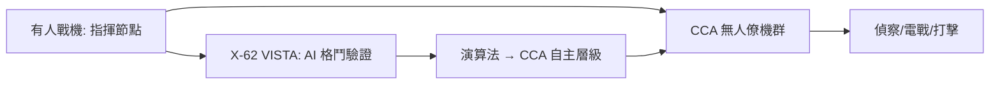

# 第 12 章 · 第 3 節 AI 氣動與無人協同戰機：設計師的最後一道題

## 當演算法學會纏鬥

2020 年代，人工智慧闖入了航空工程兩個最深邃的房間：設計與飛行。

在設計端，AI 氣動優化以生成式模型與強化學習掃描傳統參數化方法觸及不到的構型空間：機翼的展向扭轉、進氣道的曲率、甚至乘波體前緣，都可以交給演算法在 CFD 迴路中反覆演化。工程師的角色從「畫出形狀」轉為「定義目標函數與約束」——我們教電腦的不再是怎麼畫，而是什麼叫好。

在飛行端，美國 DARPA 的 ACE（Air Combat Evolution）計畫把空中纏鬥交給了 AI。2023 至 2024 年間，改裝的 X-62 VISTA 變穩定性驗證機在加州愛德華茲基地與有人駕駛的 F-16 進行了多次**真實的空中近距格鬥（dogfight）**——AI 全程操縱飛機，與人類飛行員在視距內對抗，安全監督員坐在後座。這是航空史上第一次，格鬥的直覺——那些越戰以來累積的能量機動與角度機動哲學——被寫成了神經網路的權重。

## CCA：忠誠的僚機

AI 飛行的制度性出口是協同作戰飛機（CCA）：讓有人戰機指揮一批低成本、可消耗的無人僚機。XQ-58A「女武神」（Kratos 製造、經美國海軍陸戰隊與空軍試驗）等驗證機測試了「廉價、可損失、成群結隊」的新空戰經濟學；澳洲波音的 MQ-28「幽靈蝙蝠」則是盟友體系內的平行嘗試。CCA 的邏輯是制度與經濟的雙重創新：把昂貴的有人平台變成戰場上的「指揮節點」，把風險與火力下放給可量產的演算法載體——空戰的計價單位，從「一架戰機」變成「一個編隊架構」。

## 設計師角色的終極轉型

這一切把飛機設計師推離了製圖板。未來的設計對象不是一副機翼，而是**系統的架構**：感測器如何融合、任務軟體如何升級、開放式架構（如 MOSA）如何讓第三方快速插入新能力。設計師成為「演算法與鋼鋁之間的翻譯者」。

## 沒有標準答案的責任

AI 戰機同時打開了最困難的問題。X-62 的纏鬥是在人類監督下進行的；但當自主層級提高，**武器授權的課責**便成為制度核心議題——美國國防部為此制定了自主武器系統的相關指令，要求人類對致命行為保持適當層級的判斷。飛機可以由演算法駕駛，但責任無法由演算法承擔。從烏菲姆切夫的方程式到神經網路的權重，航空工程史的主旋律從未改變：技術總是在物理、經濟、制度與倫理的四重邊界上飛行——而設計師的職業，就是在這些邊界之間，畫出下一條航線。
