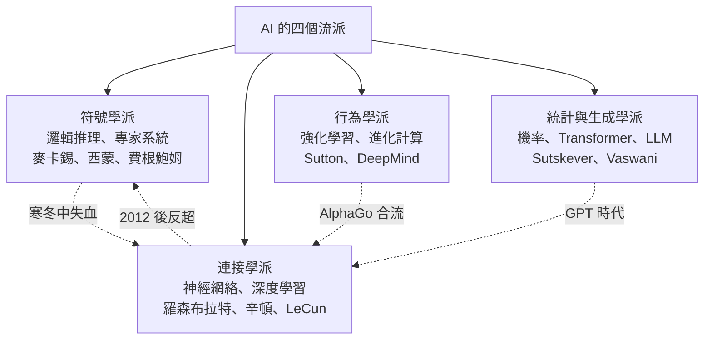

# 前言：矽基靈魂的點火者——人工智慧設計者如何用數學與程式碼重新定義「思考」的本質

## 一個文明的終極問題

人類文明建過金字塔、上過月球，但只有一個問題被稱為「終極」：心智是什麼？它可以被造出來嗎？

本書的主角們——圖靈、麥卡洛克、皮茨、麥卡錫、明斯基、西蒙、羅森布拉特、費根鮑姆、辛頓、楊立昆、李飛飛、哈薩比斯、Sutskever、Altman——不是在寫論文，而是在進行一場持續八十年的回答。他們分屬四個流派，卻都在做同一件事：把「思考」翻譯成數學與程式。

## 四大流派的地圖

## 本書的三條主軸

### 1. 潮起潮落的兩次寒冬（經濟與制度主軸）

AI 的歷史不是線性進步，而是「狂喜—幻滅—寒冬—復燃」的循環：

- 第一次寒冬（1973 起）：萊特希爾報告＋DARPA 撤資；
- 第二次寒冬（1987 起）：專家系統泡沫破裂＋第五代計畫失敗；
- 每次寒冬的倖存者（辛頓、LeCun、Bengio）都成為下一輪革命的主祭。

### 2. 算力、數據、演算法三重奏（科技主軸）

深度學習革命並非單一發明，而是三條曲線同時到位：GPU 平行算力（NVIDIA）、網際網路級數據（ImageNet）、適合大算力的演算法（CNN／Transformer）。本書將反覆出現這個三角結構。

### 3. 人物與制度的互搏（政治與文化主軸）

明斯基的書可以凍結一個領域十年；英國一份報告可以切斷全國經費；一場公司內鬥（OpenAI 董事會風波）可以震撼全球股市。AI 從來不只是科學，更是權力、資本與信仰的角力場。

## 閱讀指南

- 11 章、每章 3 節，嚴格依年代軸排列；
- 每節含「前因—事件—後果」結構，強調驅動關係；
- 使用標準 GitHub Markdown，含 LaTeX 數式與 Mermaid 圖；
- 全部事件與人物言論均有史可查，推測處明確註明。

一句話作為楔子：這是一部關於「人如何親手造出另一種心智」的史詩——而造神者自己，還沒想清楚結局。

---

下一章：[第 1 章　阿蘭·圖靈與麥卡洛克：心智機械化的理論創世紀](01.1-M-P模型.md)
