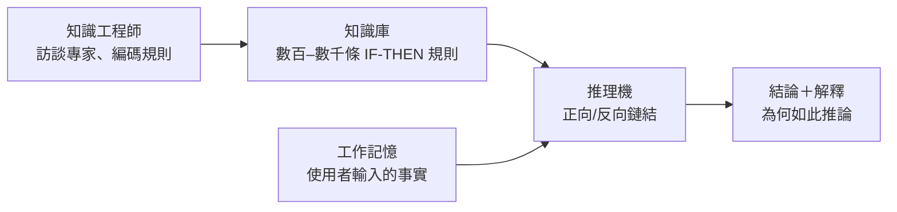

# 第 5 章　愛德華·費根鮑姆與專家系統（Expert Systems）的商業狂潮

## 本章導言

寒冬之後，AI 以「專家系統」的商業形象復活：把人類專家的判斷寫成規則庫。本章三節：5.1 費根鮑姆；5.2 DENDRAL 與 MYCIN；5.3 第五代計畫與二次寒冬。

---

# 5.1 愛德華·費根鮑姆：「專家系統之父」與把人類專家經驗寫成 If-Then 規則庫的狂想

## 5.1.1 從卡內基到斯坦福

愛德華·費根鮑姆（Edward Feigenbaum, 1936–）是西蒙的學生（卡內基理工博士），1950s 末追隨紐厄爾—西蒙的符號傳統；1965 年起任教斯坦福。他提出的核心命題後來被稱為「知識即力量」原則（Knowledge is Power）：

> 專家系統的威力來自其擁有的特定領域知識，而非通用推理機制的精巧。

這與紐厄爾—西蒙的通用問題求解（GPS）路線刻意分道——不要「通用」，要「專深」。

## 5.1.2 If-Then 規則庫與推理機

專家系統的架構簡單到可以一張圖說完：

新職業「知識工程師（knowledge engineer）」誕生——訪談專家、把口述經驗翻譯成規則。這是 AI 第一次創造出自己的「藍領—白領」分工。

## 5.1.3 商業化里程碑

- 1980 年 DEC 的 XCON（R1，CMU John McDermott 開發）為計算機訂單配置系統，每年為 DEC 省下數千萬美元——第一個大型商業成功案例；
- 1981–85 年美國湧現上百家專家系統公司（Teknowledge、Intellicorp 等）；1985 年《Fortune》估計相關市場數億美元、多家大企業設立「AI 部門」；
- 1982 年費根鮑姆出版《第五代》（The Fifth Generation），直白呼籲美國警覺日本挑戰——把專家系統推上國家安全議程。

費根鮑姆於 1994 年獲圖靈獎（與 Reddy 同年）。

## 5.1.4 前因後果

- 前因：符號傳統＋1970s「知識瓶頸」的自省（智能的難點在知識而非推理）＋日本競賽氛圍。
- 事件：1965 DENDRAL 起步、1978 XCON 前身、1980 商轉。
- 後果：AI 由實驗室學科變成產業；「知識獲取瓶頸」同時成為埋在繁榮下的地雷（5.3）。

---

下一節：[5.2 DENDRAL 與 MYCIN](05.2-DENDRAL與MYCIN.md)
