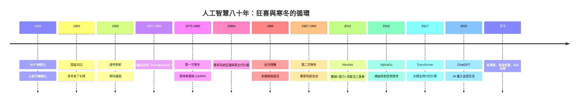

# 結語：圖靈夢想的終點——人工智慧設計者作為人類文明火種的延伸者

## 一條八十年的主鏈

把全書的節點連起來，會看到 AI 不是一條直線，而是一個反覆點火、熄火、再以更大規模復燃的引擎：

## 五條貫穿全書的規律

### 1. 範式的勝負由「期待管理」決定

紐時豪言（3.2）與專家系統泡沫（5.3）兩次過熱、兩次寒冬——AI 的科學難題之外，真正的殺手是敘事與兌現的落差。2010s 的深度學習之所以站穩，正因為它以基準競賽（ImageNet）代替媒體豪言。

### 2. 異端的耐心是一種資本

辛頓們在寒冬中堅持三十年，靠的是一個簡單的判斷：「大腦能學，網絡就應該能學。」當數據與算力到位，正確的思想自動復權。科學史的懲罰是即時的，補償是遲到但不缺席的。

### 3. 算力、數據、演算法缺一不可

反向傳播（1986）等了二十六年才等到 GPU 與 ImageNet；Transformer（2017）一出場即配齊三者。技術革命的時點從不由單項發明決定，而由三角閉環的交點決定。

### 4. 治理與技術同速進化才安全

從明斯基的書到萊特希爾報告，從 Superalignment 解散到 Bletchley 峰會——AI 的每一個能力台階，都同步製造一次制度壓力測試。控制權問題不是 AI 的附錄，而是主章。

### 5. 人物的性格就是技術的路徑

圖靈的哲學直覺、明斯基的批判鋒芒、辛頓的固執、Sutskever 的信仰、Altman 的務實、哈薩比斯的神經科學視野——每一次架構選擇背後，都是一個人的生命史。

## 一句總結

> 水車延長了肌肉，工具機延長了手，動力機器延長了意志——而人工智慧，延長的是思考本身。
>
> 八十年前，圖靈問「機器能思考嗎」；八十年後，問題反轉為「人類能否駕馭會思考的機器」。從麥卡洛克的一個數學神經元，到今日億萬參數的大模型，這部造神史詩的每一行，都是人類文明火種的延伸。

火種已在手中，方向仍由人定。

---

全書完 ｜ 回到 [目錄](README.md)
