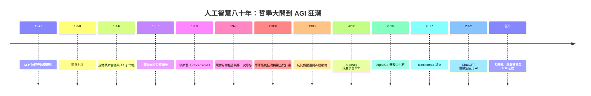

# 《人工智慧的故事：從圖靈測試、達特茅斯狂妄、神經網絡兩度寒冬到 Transformer 與 AGI 聖杯》

> 專為 AI 研究者、軟體工程師、科技史研習者、科技狂熱者與未來文明觀察者設計的專題史。
>
> 「人工智慧」從來不只是演算法與數據的堆疊，它是人類試圖用矽晶片與數學公式重現自身心智、乃至超越自身智商極限的「終極造神史詩」。從圖靈在二戰密碼戰餘燼中提出的哲學大問「機器能思考嗎？」，到達特茅斯會議上的群星閃耀，走過寒冬裡的經費斷絕與專家系統崩潰，再到神經網絡的死灰復燃、深度學習的暴力美學，直到當代的大語言模型（LLM）與通用人工智慧（AGI）狂潮——本書 100% 基於真實歷史事件，以 AI 傳奇設計者與先驅者（人物）為核心主軸，嚴格按年代軸推進。

## 全書結構

---

## 目錄

### 前言：矽基靈魂的點火者——人工智慧設計者如何用數學與程式碼重新定義「思考」的本質

見 [00-preface.md](00-preface.md)

---

### 第一篇：哲學大問與神經元數學模型的破曉（1940 年代 – 1950 年代）

* 第1章-阿蘭·圖靈與麥卡洛克：心智機械化的理論創世紀
    * [1.1-麥卡洛克與皮茨：1943 年第一個簡化神經元（M-P 模型）的數學誕生](01.1-M-P模型.md)
    * [1.2-阿蘭·圖靈與 1950 年劃時代論文《計算機器與智慧》：提出著名的「圖靈測試」](01.2-圖靈測試.md)
    * [1.3-哲學家與邏輯學家的交鋒：機器能擁有靈魂嗎？早期 AI 思想對「符號與感覺」的探索](01.3-符號與感覺.md)

* 第2章-1956 年達特茅斯會議：群星閃耀與「Artificial Intelligence」詞彙的誕生
    * [2.1-約翰·麥卡錫：發起達特茅斯夏令營、正式命名「人工智慧」的傳奇大師](02.1-麥卡錫命名.md)
    * [2.2-明斯基、西蒙與紐厄爾：展示第一個 AI 程式「邏輯理論家」（Logic Theorist）](02.2-邏輯理論家.md)
    * [2.3-狂妄的暑期計畫：為什麼這群天才認為「一個夏天、十個人」就能解決 AI 的核心問題？](02.3-達特茅斯狂想.md)

### 第二篇：感知機的狂喜、符號學派霸權與第一次 AI 寒冬（1950 年代末 – 1970 年代）

* 第3章-弗蘭克·羅森布拉特與感知機（Perceptron）：神經網絡的第一次高光
    * [3.1-弗蘭克·羅森布拉特與 1957 年感知機：能自主學會識別形狀的硬體神經網絡](03.1-感知機.md)
    * [3.2-《紐約時報》的世紀豪言：「美軍即將擁有能思考、能說話、能自我複製的機械」](03.2-紐時豪言.md)
    * [3.3-夢想的破滅：早期感知機只能處理線性可分問題的致命物理極限](03.3-線性可分極限.md)

* 第4章-馬文·明斯基的打擊與第一次 AI 寒冬（Winter is Coming）
    * [4.1-明斯基與派珀特的 1969 年著作《Perceptrons》：證明感知機無法解決 XOR 問題](04.1-明斯基打擊.md)
    * [4.2-符號學派 vs 連接學派：兩大派系對資源與學術話語權的長期對峙](04.2-符號vs連接.md)
    * [4.3-1973 年英國《萊特希爾報告》與美國 DARPA 撤資：長達十年的第一次冰河期](04.3-萊特希爾報告.md)

### 第三篇：專家系統的興衰與神經網絡的異端復興（1980 年代 – 1990 年代）

* 第5章-愛德華·費根鮑姆與專家系統（Expert Systems）的商業狂潮
    * [5.1-愛德華·費根鮑姆：「專家系統之父」與把人類專家經驗寫成 If-Then 規則庫的狂想](05.1-費根鮑姆.md)
    * [5.2-DENDRAL 與 MYCIN：在化學結構分析與醫療診斷上展現的驚人潛力](05.2-DENDRAL與MYCIN.md)
    * [5.3-日本「第五代計算機計畫」的慘敗與第二次 AI 寒冬：專家系統泡沫破裂](05.3-第五代計畫.md)

* 第6章-傑弗里·辛頓、楊立昆與反向傳播（Backpropagation）的孤膽救援
    * [6.1-傑弗里·辛頓：在全學界冷眼下堅持研究多層神經網絡與反向傳播的學術「異端」](06.1-辛頓反向傳播.md)
    * [6.2-楊立昆與 CNN 卷積神經網絡：1989 年貝爾實驗室手寫數字識別（LeNet）的突破](06.2-LeNet.md)
    * [6.3-支援向量機（SVM）與統計學習的壓制：神經網絡為何被嘲諷為「黑盒子」而再度低谷？](06.3-SVM壓制.md)

### 第四篇：算力大爆發、深度學習革命與 AlphaGo 震撼（2000 年代 – 2010 年代）

* 第7章-辛頓、李飛飛與 ImageNet：深度學習（Deep Learning）的破曉引爆點
    * [7.1-李飛飛與 ImageNet 標註資料集：用百萬張圖片為 AI 築起龐大數據基石](07.1-ImageNet.md)
    * [7.2-2012 年 ImageNet 大賽：辛頓與弟子 Krizhevsky 憑 AlexNet＋GPU 以碾壓姿態奪冠](07.2-AlexNet.md)
    * [7.3-顯示卡的奇妙轉折：黃仁勳與辛頓團隊的交集，平行運算如何成為深度學習的神油？](07.3-GPU轉折.md)

* 第8章-戴密斯·哈薩比斯與 DeepMind：AlphaGo 橫掃圍棋世界的帝國史詩
    * [8.1-戴密斯·哈薩比斯：從圍棋神童、遊戲開發者到創立 DeepMind 的傳奇人生](08.1-哈薩比斯.md)
    * [8.2-深度強化學習：DQN 演算法如何自己學會打 Atari 街機遊戲？](08.2-DQN.md)
    * [8.3-2016 年首爾「世紀之戰」：AlphaGo 4:1 擊敗李世石與第 37 手「神之一手」](08.3-AlphaGo.md)

### 第五篇：Transformer 降臨、大語言模型與 AGI 聖杯之戰（2010 年代末 – 至今）

* 第9章-谷歌八武士與《Attention Is All You Need》：Transformer 演算法的宇宙級突破
    * [9.1-2017 年谷歌論文八位作者（Ashish Vaswani 等）：擺脫 RNN 序列限制、發明自注意力機制](09.1-八武士.md)
    * [9.2-Transformer 架構的神奇特質：平行化訓練與大規模預訓練的基石](09.2-自注意力.md)
    * [9.3-「谷歌八武士」離職潮：這群天才如何散佈矽谷、創立 Anthropic、Character.ai、Cohere 等新巨頭？](09.3-離職潮.md)

* 第10章-薩姆·奧特曼、伊利亞·蘇茨克維與 OpenAI：GPT 狂潮與生成式 AI 爆發
    * [10.1-OpenAI 的非營利初衷：Altman、Musk 與 Sutskever 為對抗 Google 壟斷而設立的聖地](10.1-OpenAI創立.md)
    * [10.2-Ilya Sutskever 的信仰：「Scaling Law」——只要給足數據與算力，智慧就會湧現](10.2-ScalingLaw.md)
    * [10.3-ChatGPT 誕生與微軟數百億美元入股：從 GPT-1 到 GPT-4 的 LLM 顛覆](10.3-ChatGPT.md)

* 第11章-多模態、具身智慧（Embodied AI）與通用人工智慧（AGI）的終極前沿
    * [11.1-Sora、Gemini 與多模態融合：AI 如何開始理解物理世界的視覺與聲學規律？](11.1-多模態.md)
    * [11.2-具身智慧與人形機器人：當 AI 擁有鋼鐵軀體——黃仁勳與波士頓動力的次世代狂想](11.2-具身智慧.md)
    * [11.3-AGI 的安全與倫理博弈：Superalignment、人類控制權與矽谷宮鬥劇的背後本質](11.3-AGI安全.md)

---

### 結語：圖靈夢想的終點——人工智慧設計者作為人類文明火種的延伸者

見 [12-epilogue.md](12-epilogue.md)

---

## 💡 本目錄亮點

1. 完整穿透人工智慧八十年發展史：圖靈測試與達特茅斯會議 → 羅森布拉特感知機與第一次寒冬 → 專家系統興衰與辛頓反向傳播 → ImageNet + AlexNet → AlphaGo → Transformer 論文 → ChatGPT 狂潮 → 具身智慧與 AGI 前沿。
2. 深度解構 AI 演進的核心流派：
   - 符號學派（Symbolic AI）：邏輯推理、If-Then 專家系統、Lisp／Prolog；
   - 連接學派（Connectionism）：感知機、CNN／RNN、反向傳播、深度學習；
   - 行為學派與強化學習：Q-Learning、DQN、AlphaGo、RLHF；
   - 生成式與大模型：Transformer、Self-Attention、Scaling Law、多模態融合。
3. 主語完全聚焦於人物與史實：每章以圖靈、麥卡錫、明斯基、羅森布拉特、辛頓、楊立昆、李飛飛、哈薩比斯、Sutskever、Altman 等人的性格、論文突破、商業衝突與關鍵選擇為軸心，符合真實歷史記載。
4. 結構嚴謹：全書 11 章，每章 3 個深度小節，重視科技、經濟、制度、文化、政治、思想、教育互相的驅動關係。
