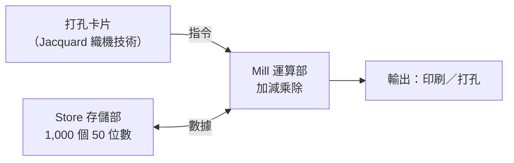

# 第 2 章　查爾斯·巴貝奇與愛達·洛夫萊斯：機械計算機上的第一串程式指令

## 本章導言

19 世紀的倫敦，一位脾氣火爆的數學家與一位詩人之女，聯手寫下了機械計算的第一章。本章三節：2.1 差分機與分析機；2.2 洛夫萊斯的程式；2.3 「指令與數據分離」的思想史。

---

# 2.1 查爾斯·巴貝奇（Charles Babbage）的分析機：將重複性數學計算交給齒輪與閥門的瘋狂構想

## 2.1.1 差分機：從數表的錯誤說起

巴貝奇（1791–1871，劍橋盧卡斯數學教授）1821 年檢查天文數表時（與 Herschel 對照，發現錯誤百出）怒言：「我真希望這些計算是用蒸汽做的。」他設計差分機（Difference Engine, 1822 提案）：以多級齒輪差分累加，自動生成多項式數表——因為任何解析函數可在小區間內以多項式逼近。英國政府 1823 年起資助；工程反覆（工具機精度、資金與契約糾紛），最終 1842 年政府撤資，完整機器巴貝奇生前未建成（瑞典 Scheutz 父子 1853 年造出可用的縮小版差分機並售予美國 Observatory、英國政府）。

## 2.1.2 分析機：一台沒有被造出來的通用計算機

約 1834 年起，巴貝奇構思分析機（Analytical Engine）——機械形式的通用計算機：

它具備現代計算機的全部架構特徵：存儲與運算分離、程序控制、條件分支、循環。巴貝奇為此設計了數千張精密圖紙，終其一生只造出局部模型；1871 年去世時，分析機仍是紙上的帝國。

## 2.1.3 為什麼失敗（工程史經典案例）

1. 精度經濟學：所需齒輪公差超出當時機床工業（見《工具的故事》第 4 章）的可負擔水平；
2. 資金與契約：政府資助與巴貝奇的完美主義互相消耗；
3. 需求時差：數表市場不足以養活通用計算機——「通用性」的商業價值要等電子時代才顯現。

## 2.1.4 前因後果

- 前因：1.3 的數表手工生產痛點＋Jacquard 打孔卡片＋精密機械工業。
- 事件：1822 差分機提案、1834 分析機構想、1842 政府撤資。
- 後果：程序控制的完整概念被寫下（由洛夫萊斯闡明），成為 20 世紀計算機架構的先聲——雖然直接影響有限（Turing、von Neumann 更受數理邏輯影響），但它是「程序自動化」的第一次完整想像。

---

下一節：[2.2 洛夫萊斯](02.2-洛夫萊斯.md)
