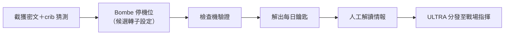

# 第 3 章　阿蘭·圖靈與「炸彈機（Bombe）」：二戰密碼戰中的解密演算法絕殺

# 3.2 圖靈與 Gordon Welchman 的反向工程：設計全自動「炸彈機」在幾小時內窮舉篩選

## 3.2.1 圖靈的邏輯：從「環」開始

1939 年 9 月圖靈入駐布萊切利園（Bletchley Park, B.P.）。他針對德國海軍 Enigma 的每日密鑰，設計「環（loop）」攻擊：利用已知或猜測的明文—密文對（crib），構造字母依賴的閉環，使錯誤的轉子設定在鏈上自相矛盾——把 $10^{20}$ 的組合空間壓縮到可在機器上逐一檢驗的子集。此即 Bombe 的數學核心：矛盾即剪枝。

## 3.2.2 Welchman 的對角線板

Gordon Welchman（劍橋拓撲學家）發明「對角線板（diagonal board）」：利用反射器「字母不自映射」的性質，在電路層面把矛盾傳導加速，令單台 Bombe 的篩選效率提高一個量級。兩人合作的第一台英國 Bombe（工程師 Harold Keen 建造，命名「Victory」）1940 年 3 月 18 日運行。

## 3.2.3 作業流程：演算法的工業化

到戰爭末期，布萊切利園運行約 200 台 Bombe（遺產計畫重建機每日 7,500 轉仍可復現），北約式分工：截聽、翻譯、密碼分析、情報綜合、分發——現代「數據流水線」的戰時原型。

## 3.2.4 前因後果

- 前因：3.1 波蘭移交＋圖靈 1936 可計算性理論（矛盾剪枝的思想底座）＋英國機電工業。
- 事件：1940 Bombe 上線、1941 海軍 Enigma 突破（捕獲 U-110 與氣象船的密碼材料為助攻）。
- 後果：ULTRA 情報改寫大西洋之戰與北非戰局（3.3）；圖靈戰後轉向通用電子計算機（ACE）——Bombe 是「用機器執行搜索演算法」的第一次大規模實戰驗證。

---

下一節：[3.3 布萊切利園](03.3-布萊切利園.md)
