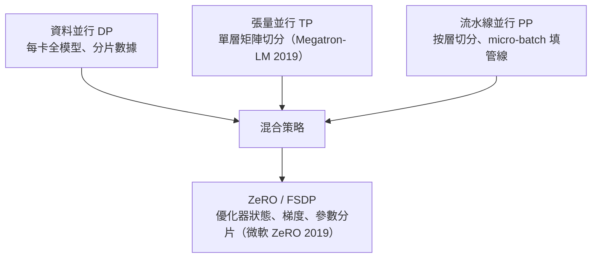

# 第 9 章　梯度下降、反向傳播與大規模 AI 最佳化的暴力美學

# 9.3 軟硬體協同優化：演算法工程師如何透過剪枝、量化與張量並行，將千億參數模型塞進晶片？

## 9.3.1 剪枝與知識蒸餾：把網絡「變小」

- 剪枝：1990 年 LeCun（OBD 思想源頭）與 2015 年 Han et al.（Deep Compression）證明大量權重可移除而精度幾乎不損（彩票假說 2019 給出理論視角：存在可訓練的稀疏子網）；
- 知識蒸餾：Hinton 等 2015 提出——大模型（teacher）的軟標籤教小模型（student），AlexNet 級壓縮案例使移動端部署可行；
- 結構化 vs 非結構化：稀疏性要在硬體上「兌現」，需配合 N:M 稀疏張量核等晶片特性（NVIDIA Ampere 起硬體支援）。

## 9.3.2 量化：以低精度逼近高精度

把 fp32 權重壓到 int8／int4：

$$
x_q \approx \mathrm{round}\left(\frac{x - s}{\Delta}\right)\quad (\text{scale } s,\ \text{zero-point } \Delta)
$$

實務路線：訓練後量化（PTQ）與量化感知訓練（QAT）；LLM 時代的 GPTQ（2022）、AWQ（2023）使 70B 模型可塞進單卡。經濟意義直接：顯存即成本，量化每減半一個量級，推理成本近乎減半——這是 2023–25 年端側 AI 與開源模型爆發的技術引擎之一。

## 9.3.3 分佈式訓練：把山切成數千塊同時挖

千億參數的訓練必須切分：

通信與計算的重疊（NCCL、Ring AllReduce，Baidu 2017 提出 Ring 演算法）決定擴展效率——「演算法—系統—硬體」的協同設計自此成為大模型公司的核心壁壘（NVIDIA 的算力壟斷、國產晶片適配潮皆源於此）。

## 9.3.4 前因後果

- 前因：9.1/9.2 的訓練體系＋晶片架構（張量核）＋成本壓力。
- 事件：2015–2019 壓縮與並行基礎、2020–25 大模型工程化。
- 後果：AI 從實驗室技術變成可規模部署的基礎設施；第 10 章的量子演算法則預告另一種「並行」——以疊加態同時探索所有分支。

---

下一章：[第 10 章　量子演算法](10.1-Shor演算法.md)
