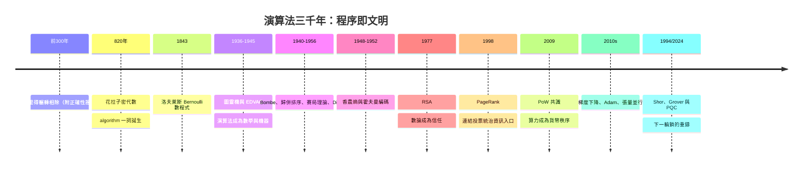

# 結語：邏輯的無形建築師——演算法作為人類文明突破時空與算力極限的永恆武器

## 一條三千年的主鏈

從亞歷山大的紙草到矽谷的資料中心，演算法史是一條不斷「把直覺變成程序、把程序變成權力」的長鏈：

## 五條貫穿全書的規律

### 1. 好演算法的特徵是「不可操縱」

Enigma 敗於協議的縫、搜索引擎敗於關鍵字堆砌、PageRank 勝於全圖投票、比特幣勝於算力加權——信任的設計要點永遠是：不給單點操縱的機會。

### 2. 每一次複雜度躍遷都重寫一次行業

$O(n^2)$ 到 $O(n\log n)$ 的排序差異在千萬數據上就是小時與秒；$O(N)$ 到 $O(\sqrt N)$ 的搜索差異讓對稱密碼全線換鑰。演算法的漸進記號不是數學裝飾，而是經濟學。

### 3. 理論常常先行、工程隨後兌現

洛夫萊斯等了八十年、反向傳播等了二十六年、格密碼從 LWE（2005）到標準（2024）只等了十九年——理論與應用的時差在縮短，但「先想通、後做對」的次序從未改變。

### 4. 演算法的安全期是有限的

Euclid 用了兩千年、Huffman 用了七十年、RSA 用了四十七年——每一把鎖都有物理或數學的壽命。PQC 的賽跑提醒我們：文明的職責不是造出永恆的鎖，而是比解鎖者早一步換鎖。

### 5. 演算法設計者是人類抽象能力的化身

從花拉子密到 Dijkstra 到 Shor，他們的共同點是：把混沌的問題世界翻譯成有限的、可驗證的步驟。這是智人區別於其他物種的最高技藝——而本書展示的每一節，都是這技藝的一次登頂。

## 一句總結

> 水車延長了肌肉，動力機器延長了意志，人工智慧延長了思考——而演算法，是這一切背後的語法：人類以邏輯書寫的、可被任何機器執行的、關於「如何解決問題」的永恆詩篇。

三千年前它在泥板上，三千年後它在量子位元裏。寫它的手換了一代又一代，字句卻始終未變：輸入、步驟、輸出——以及一顆想要更聰明的心。

---

全書完 ｜ 回到 [目錄](README.md)
