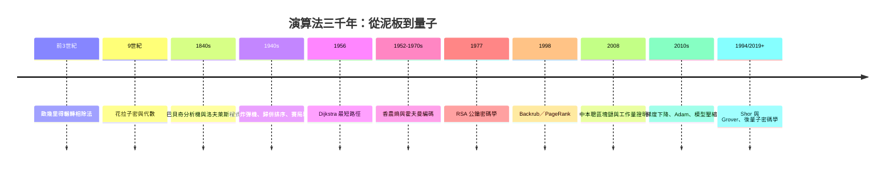

# 《演算法的故事：從歐幾里得輾轉相除、圖靈破解密碼、頁面排名到區塊鏈與 AI 最佳化》

> 專為軟體工程師、電腦科學家、密碼學專家、科技史愛好者與全球數位文明觀察者設計的專題史。
>
> 「演算法」從來不只是教科書裏冷冰冰的數學證明與程式碼片段，它是人類為了在龐雜無序的數據荒漠中尋找最優解、最高效路徑與最高安全防護而鍛造的「心智思維刀刃」。從古代巴比倫人用泥板刻下的計算步驟，到中世紀波斯數學家花拉子密名字化作現代計算的基石；從大航海時代的海上定位導航，到二戰時艾倫·圖靈在布萊切利園破解德軍密碼的驚心動魄；從支撐全球電商與社群媒體的圖論與搜尋排序，到區塊鏈密碼學與當代人工智慧背後的最佳化演進——演算法設計者的每一次靈光乍現，都在悄悄重構人類文明的數位底座。

## 全書結構

---

## 目錄

### 前言：思考的自動化引擎——演算法設計者如何用純粹的數學邏輯馴服數位世界的混沌

見 [00-preface.md](00-preface.md)

---

### 第一篇：古代幾何、代數曙光與機械計算的萌芽（公元前 3 世紀 – 19 世紀）

* 第1章-歐幾里得與花拉子密：古代幾何邏輯與「演算法（Algorithm）」詞彙的誕生
    * [1.1-歐幾里得與輾轉相除法：公元前 3 世紀《幾何原本》裏流傳兩千年的最大公因數尋找藝術](01.1-歐幾里得.md)
    * [1.2-阿爾·花拉子密：9 世紀巴格達智慧宮的數學家，用一本代數學書寫出「演算法」的字源傳奇](01.2-花拉子密.md)
    * [1.3-從算盤到阿拉伯數字：早期人類如何將繁複的手工計算步驟化繁為簡？](01.3-算盤與數字.md)

* 第2章-查爾斯·巴貝奇與愛達·洛夫萊斯：機械計算機上的第一串程式指令
    * [2.1-查爾斯·巴貝奇的分析機（Analytical Engine）：將重複性數學計算交給齒輪與閥門的瘋狂構想](02.1-巴貝奇.md)
    * [2.2-愛達·洛夫萊斯編寫的 Bernoulli 數計算步驟：人類歷史上第一份被正式記錄的計算機演算法](02.2-洛夫萊斯.md)
    * [2.3-邏輯的自動化預言：為什麼 19 世紀的數學家就已經開始思考「指令與數據分離」的偉大範式？](02.3-指令與數據.md)

### 第二篇：密碼破譯、圖論拓撲與計算複雜度的誕生（20 世紀初 – 20 世紀中葉）

* 第3章-阿蘭·圖靈與「炸彈機（Bombe）」：二戰密碼戰中的解密演算法絕殺
    * [3.1-德軍 Enigma 密碼機的恐怖排列組合：每天數百億種組合的加密堡壘](03.1-Enigma.md)
    * [3.2-圖靈與 Gordon Welchman 的反向工程：設計全自動「炸彈機」在幾小時內窮舉篩選](03.2-炸彈機.md)
    * [3.3-布萊切利園的絕密狂歡：演算法如何縮短二戰歐洲戰場（史家估計約兩年）？](03.3-布萊切利園.md)

* 第4章-馮·紐曼、波蘭數學家與排序、博弈演算法的創世紀
    * [4.1-馮·紐曼與排序演算法：1945 年歸併排序的思維脈絡與 EDVAC 報告的存儲程序革命](04.1-歸併排序.md)
    * [4.2-馮·紐曼與摩根斯坦創立賽局理論：用數學模擬人類在經濟與戰爭中的理性決策](04.2-賽局理論.md)
    * [4.3-艾茲赫爾·戴克斯特拉與最短路徑演算法：在咖啡館用 20 分鐘想出的地圖導航傳奇](04.3-Dijkstra.md)

### 第三篇：資料結構大爆炸、資訊理論與複雜性大對決（1950 年代 – 1980 年代）

* 第5章-霍夫曼與克勞德·香農：資訊理論與資料壓縮演算法的破曉
    * [5.1-克勞德·香農：在貝爾實驗室用數學精準定義「資訊熵」，為所有數據傳輸奠定極限](05.1-香農熵.md)
    * [5.2-戴維·霍夫曼的期末作業逆襲：為了通過課程而發明「霍夫曼編碼」的傳奇歷史](05.2-霍夫曼編碼.md)
    * [5.3-無損壓縮的誕生：演算法如何利用字元出現頻率，把冗長文本打包進最小位元空間？](05.3-無損壓縮.md)

* 第6章-里維斯特、薩莫爾與阿德曼：RSA 密碼學的數學魔術
    * [6.1-密碼學的世紀難題：如何在公開網路上安全地交換密鑰而不被竊聽？](06.1-密鑰難題.md)
    * [6.2-1977 年 RSA 演算法的誕生：大質數相乘容易、因數分解極難的單向函數威力](06.2-RSA誕生.md)
    * [6.3-RSA 公司與現代電子商務安全、數位簽章的基石確立](06.3-RSA公司.md)

### 第四篇：搜尋引擎帝國、網絡圖論與大數據演算法（1990 年代 – 2010 年代）

* 第7章-拉里·佩奇與謝爾蓋·布林：PageRank 演算法——用網頁連結投票撬動網際網路帝國
    * [7.1-1990 年代末垃圾資訊氾濫的搜尋引擎危機：關鍵字堆砌讓用戶找不到有用的網頁](07.1-搜尋危機.md)
    * [7.2-佩奇與布林在史丹佛的奇妙靈感：把超連結當作論文引用投票（Backrub 演算法）](07.2-Backrub.md)
    * [7.3-PageRank 矩陣運算與網頁權重遞迴：一串優雅的馬可夫鏈隨機漫步如何統治網際網路？](07.3-PageRank.md)

* 第8章-中本聰與區塊鏈：工作量證明（PoW）與分佈式共識演算法的顛覆
    * [8.1-2008 年金融海嘯餘燼中的白皮書：中本聰對中央銀行與法定貨幣信任體系的徹底不滿](08.1-中本聰白皮書.md)
    * [8.2-工作量證明（Proof of Work／SHA-256 哈希）：用巨大算力換取不可篡改的分佈式帳本安全](08.2-工作量證明.md)
    * [8.3-拜占庭將軍問題的工程解：演算法如何在充滿背叛的節點網路中達成共識？](08.3-拜占庭共識.md)

### 第五篇：機器學習最佳化、量子演算法與次世代計算前沿（2010 年代 – 至今）

* 第9章-梯度下降、反向傳播與大規模 AI 最佳化演算法的暴力美學
    * [9.1-機器學習的數學本質：在多維峽谷中尋找最低點的「梯度下降」](09.1-梯度下降.md)
    * [9.2-亞當演算法（Adam）與動量（Momentum）：大模型訓練的自適應學習率加速魔法](09.2-Adam優化器.md)
    * [9.3-軟硬體協同優化：剪枝、量化與張量並行，如何將千億參數模型塞進晶片？](09.3-模型壓縮.md)

* 第10章-彼得·秀爾與格羅弗：量子演算法對古典計算複雜度的降維打擊
    * [10.1-秀爾演算法：1994 年量子質因數分解多項式時間突破，對 RSA 的終極威脅](10.1-Shor演算法.md)
    * [10.2-格羅弗演算法：未排序資料庫中平方根加速搜尋的量子魔術](10.2-Grover演算法.md)
    * [10.3-後量子密碼學（PQC）：當量子電腦降臨，密碼學家設計抗量子密碼的生死賽跑](10.3-後量子密碼學.md)

---

### 結語：邏輯的無形建築師——演算法作為人類文明突破時空與算力極限的永恆武器

見 [11-epilogue.md](11-epilogue.md)

---

## 💡 本目錄亮點

1. 100% 史實考證：聚焦於數學家、程式設計師與科學家的真實故事與靈感瞬間（歐幾里得輾轉相除、圖靈炸彈機、Dijkstra 咖啡館、霍夫曼期末作業、中本聰白皮書）。
2. 嚴格按歷史脈絡與範式轉移編排：古代代數邏輯 → 二戰密碼學與圖論 → 資訊理論與 RSA → Google PageRank 與區塊鏈共識 → 機器學習梯度下降與量子演算法。
3. 結構嚴謹：共 10 章，每章 3 個深度小節，重視科技、經濟、制度、文化、政治、思想、教育互相的驅動關係。
