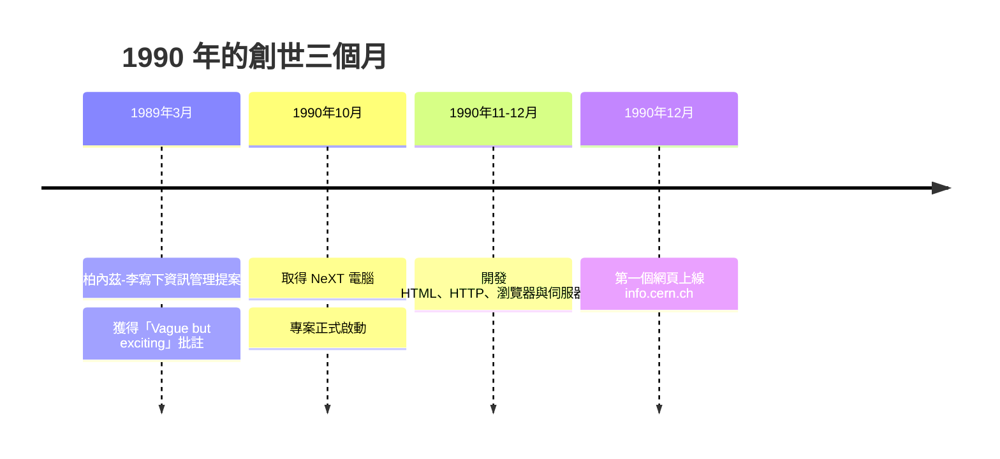

# NeXT 電腦與 CERN：HTML 與第一個網頁伺服器的誕生

## 一台黑色立方體

1990 年秋天，日內瓦郊外的歐洲核子研究組織（CERN）裏，英國軟體工程師提姆·柏內茲-李（Tim Berners-Lee）在爭取到的一台 NeXT 電腦上開始寫程式。這台機器是賈伯斯 1985 年離開蘋果後創辦的 NeXT 公司的產品，黑色的鎂鋁合金立方體，當年售價高達六千五百美元。它不是市場主流，卻內建了完善的作業系統與介面開發工具——賈伯斯為商業市場打造的這台失敗之作，陰錯陽差成了萬維網的搖籃。

柏內茲-李在 1989 年 3 月寫下的那份提案《Information Management: A Proposal》，上司邁克·森德爾在封面上批了六個字：「Vague but exciting.」（含糊，但令人興奮。）如今他終於可以動手實現這個「含糊」的想法：用超文本把 CERN 數千名研究員的文件、電話名冊與實驗資料連成一張網。

## 三個月的奇蹟

從 1990 年 10 月到年底，柏內茲-李完成了一件驚人的事：他寫出了三樣東西。

第一是 HTML（超文本標記語言）。他並沒有發明全新的東西，而是從既有的 SGML（標準通用標記語言）中借來語法，挑選出一組最精簡的標籤：標題、段落、清單，以及那個改變一切的 `<a>`——錨點標籤，讓文件得以連向另一份文件。第一版 HTML 只有十幾種標籤，沒有任何視覺控制的語法。這個「極簡」的決定，既是工程上的務實，也埋下了日後三十年「內容與外觀之爭」的種子。

第二是 HTTP（超文本傳輸協定），定義瀏覽器如何向伺服器請求文件。第三是第一個網頁瀏覽器兼編輯器（就在 NeXT 的介面工具上直接開發），以及第一個網頁伺服器——一個跑在 CERN 內部一台機器上的簡單程式，監聽埠號 80，回應請求。

1990 年 12 月 20 日前後，第一個網頁正式上線，網址是 http://info.cern.ch/hypertext/WWW/TheProject.html。它描述的是萬維網計畫本身——一個用來介紹自己的網頁，堪稱數位世界的自舉創世紀。

## 為什麼是超文本、為什麼是網狀

在萬維網之前，網路上已有 Gopher 這種選單階層式的資訊系統，也有 FTP 檔案傳輸與各種資料庫。柏內茲-李的洞見在於：知識的真正形態是網狀的，一份文件可以同時屬於多個脈絡，階層選單無法表達這種多對多的關係。超文本的連結讓每份文件既是終點也是起點。

這個設計哲學對日後的網頁設計影響深遠：頁面（page）成為資訊的基本單位，連結成為導航的基本手段，「一頁一個主題、以連結編織整體」成為網站資訊架構的原型。今天資訊架構師（IA）在做的事——設計內容層級與連結關係——精神上仍與 1990 年那個 NeXT 畫面一脈相承。

值得玩味的是，第一個網頁的所有視覺樣式——灰色背景、藍色連結——都不是設計的結果，而是後來瀏覽器預設樣式表的產物。真正的「網頁設計」，要到有人開始問「網頁能不能不只長這樣」時才會誕生。而那個問題的答案，將由一群 22 歲左右的美國年輕人在大西洋的另一端給出。
