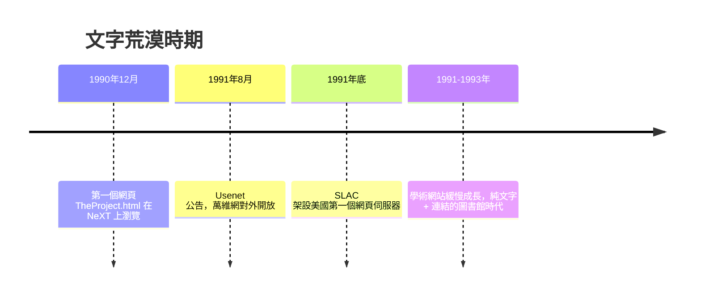

# info.cern.ch：沒有顏色與圖片的極簡創世紀

## 第一頁長什麼樣

世界上第一個網頁的網址是 http://info.cern.ch/hypertext/WWW/TheProject.html。它於 1990 年 12 月在柏內茲-李的 NeXT 電腦上首次被瀏覽，1991 年 8 月 6 日隨著他在 alt.hypertext 新聞群組的公告，正式對全世界開放。

這頁的內容毫無修飾：它標題是「World Wide Web」，正文用一個項目清單描述萬維網計畫——什麼是萬維網、有哪些參與者、如何取得瀏覽器軟體、一份常見問題列表。頁面上有幾個超連結，指向文件、軟體與聯絡方式。它是一個「自我指涉」的創世紀：第一個網頁的內容，就是介紹如何建立網頁。

今天看來，這頁的美學是「零」：沒有背景色、沒有字型選擇、沒有圖片、沒有版面分割。但正是這個零，是網頁設計的原點。所有後來的色彩、動畫與沉浸式 3D，都是從這個空白出發的偏移。

## 灰底藍字從哪裡來

有趣的是，今天人們印象中「早期網頁」的樣子——灰色背景、藍色底線的連結、紫色表示已造訪——並不來自柏內茲-李。HTML 第一版根本沒有顏色與字型的語法。這些視覺慣例是 1993 年 NCSA Mosaic 瀏覽器的預設樣式：工程師憑直覺選了淺灰背景（避免純白的刺眼）與藍色連結（藍色在當時的螢幕上是與黑色文字對比清晰、且未飽和到刺目的顏色）。

換句話說，網頁設計史上第一個「視覺決定」不是設計師做的，而是瀏覽器工程師做的預設值。這件事的深遠意義在於：當預設樣式被億萬頁面沿用，它就成了人類集體的視覺記憶。藍色等於連結——這條潛規則塑造了之後三十年網站的配色心理學，直到今天藍色仍是網際網路品牌的統治色（Facebook、Twitter、LinkedIn 都選了藍）。

## 純文字荒漠的擴張

1991 到 1993 年間，萬維網在學術圈緩慢擴張。早期的網站是 CERN、SLAC（史丹佛直線加速器中心，1991 年底架設了第一個美國網頁伺服器，用來發布論文資料庫）、以及少數大學的實驗室。頁面一律是標題加段落加清單，連結是唯一的互動。

在當時，把網頁當「出版物」來經營的概念還不存在。資訊的流通依賴兩種管道：透過連結被發現，以及透過早期搜尋引擎（1993 年後的 Aliweb、JumpStation 等索引爬蟲）被檢索。沒有視覺，就沒有品牌；沒有品牌，就沒有商業。文字荒漠的網頁世界，在本質上還是一個「科學家的圖書館」。

荒漠終將迎來色彩。1993 年，伊利諾大學的一間計算機實驗室裏，一位大學生決定讓瀏覽器顯示圖片——這個看似顯而易見的決定，在當時其實充滿爭議。下一章的主角，是馬克·安德森與 Mosaic。
