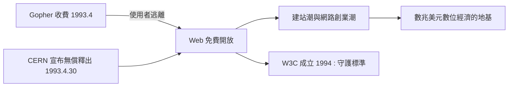

# 無償開源的抉擇：拯救網際網路未來的理想主義

## 一場必須贏的標準之戰

1993 年前後，萬維網面臨生死存亡的岔路口。當時網路上存在多個競爭的資訊系統：明尼蘇達大學的 Gopher 選單系統一度比 Web 更受歡迎。但 1993 年 4 月，明尼蘇達大學宣布對 Gopher 伺服器收取授權費，商業使用需付費取得授權。這個決定嚇退了無數想架站的機構——人們轉向完全免費的 Web。Gopher 之死，是萬維網崛起的關鍵轉折，也給柏內茲-李上了震撼的一課：一旦協定被私人圈佔，網路就會分裂。

與此同時，CERN 的管理層對 Web 計畫的支持力道有限，甚至一度考慮縮減。柏內茲-李擔心，如果任由商業公司各自實作不相容版本的 Web 技術，整個計畫會碎裂成私有帝國。他需要一個制度性的解方。

## 1993 年 4 月 30 日的宣言

1993 年 4 月 30 日，CERN 官方宣布：將萬維網的三項核心技術——HTTP 協定、HTML 語言與 URL 定址——以開放標準的形式無償釋出，不收取任何權利金，並聲明任何人都可以自由實作。

這個決定的分量，要到多年後才被完全理解。當時軟體產業的常態是專利與授權費：再往前看，影像壓縮技術 MPEG 的授權費累積了數十億美元。如果 HTML 與 HTTP 被鎖進專利，每一個網站、每一套瀏覽器、每一張網頁都得付稅。柏內茲-李與 CERN 放棄了一個可能價值數百億美元的資產，換來的是一個統一的、人人可建的網。

1994 年，柏內茲-李離開 CERN，前往麻省理工學院創立萬維網聯盟（W3C），把「守護開放標準」變成終身職業。他拒絕將技術商業化的選擇，讓他沒有成為億萬富翁，卻讓他成為科技史上少數「發明了世界卻不圈佔世界」的人物，並在 2004 年受封爵士、2016 年獲圖靈獎。

## 經濟與文化的雙重效應

無償開源在經濟上創造了零摩擦的擴散：任何大學、公司、個人只要有一台伺服器與一條網路線，就能發布網頁，不必談授權、不必付權利金。這直接催生了 1990 年代中期的網站建站潮，也讓「會寫 HTML」成為一種可以在車庫創業的技能。網景、雅虎、亞馬遜——第一代網路公司全部建立在這個免費的地基上。

在文化上，它確立了網際網路的價值觀：開放、互通、去中心化。這套價值觀日後支撐了開源軟體運動（Linux、Apache）、知識共享（Creative Commons）與維基百科。同時它也定義了網頁設計師的身分：一個在開放平台上工作、受標準而非受單一廠商支配的職業——儘管這個理想，在接下來的瀏覽器大戰中將被反覆踐踏。

一個技術能否統治世界，往往不取決於它多先進，而取決於它的擁有者願不願意放手。1993 年春天，柏內茲-李放手了。而接住這份禮物的，是美國中西部一所大學裏的一群年輕人。
