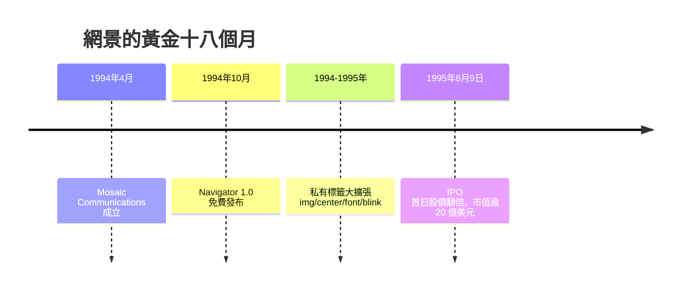

# img 標籤與網景創立：讓網頁長出圖片與 IPO 神話

## Mosaic 通訊公司

1994 年 4 月，馬克·安德森與吉姆·克拉克在加州山景城創立了公司，最初名叫 Mosaic Communications。克拉克自掏腰包投入數百萬美元，網羅了幾乎整個 NCSA Mosaic 開發團隊。但 NCSA 所屬的伊利諾大學很快提出商標與版權主張，公司被迫改名，並將瀏覽器重寫——新公司叫 Netscape Communications，新產品叫 Netscape Navigator。

1994 年 10 月，Navigator 1.0 發布。它的策略堪稱教科書級：對教育與非商業使用者完全免費，商業使用也先讓你試用（所謂「look and feel」的寬鬆授權）。在網路文化尚未被商業邏輯馴化的年代，「免費」是最好的行銷。到 1995 年年中，Navigator 已佔有瀏覽器市場的八成以上。

## 網景的標籤軍火庫

網頁設計師應當記住網景的另一個身分：它是第一個大規模「發明 HTML 標籤」的廠商。安德森在 1993 年為 Mosaic 拍板 `` 之後，網景在 1994 到 1995 年間推出了一整套改變網頁視覺能力的私有擴充：

`` 的進化版屬性（對齊、邊框）、`
` 置中標籤、改變背景與文字顏色的屬性、以及影響最深遠的 `<table>` 排版用途與 `` 標籤。此外，網景工程師路易·蒙圖利（Lou Montulli）引入了 Cookies（ originally 為解決購物車的狀態記憶問題）與 `<blink>` 閃爍標籤——後者據說是他開玩笑時提議、結果真的被寫進了瀏覽器，日後成為設計師公認的歷史災難。

這些標籤把「網頁能長什麼樣」的決定權，從瀏覽器預設值轉移到了網頁作者手中。1995 年前後的網頁開始有背景色、有置中的標題、有彩色的文字、有分隔的表格——設計師第一次可以在原始碼裏「作畫」，儘管用的畫筆粗糙得可怕。

## 1995 年 8 月 9 日：華爾街的瘋狂

1995 年 8 月 9 日，網景以每股 28 美元掛牌上市。它成立僅 16 個月、尚未獲利，卻在開盤後股價狂飆至 75 美元，收盤時市值超過 20 億美元，創下當時首日漲幅的紀錄。這一天後來被普遍視為網際網路商業時代的開幕式：它向華爾街證明，一群年輕人靠著「網路」兩個字就能募集數十億美元。

IPO 神話的連鎖反應是深遠的。它點燃了 1990 年代末的達康（dot-com）泡沫——在 2000 年泡沫破裂之前，成千上萬的網路公司以燒錢換取眼球，而「做一個網站」成為席捲全球的新職業。網頁設計師、前端工程師這兩個行業，正是在這場資本狂熱中成形的。沒有 1995 年 8 月 9 日，就沒有日後「網頁設計」作為一門產業的規模。

網景以為自己是新浪潮的舵手，但太平洋對岸的雷德蒙德，微軟的比爾·蓋茲已經把「網際網路」四個字寫進了全公司總動員的備忘錄。真正的戰爭，即將開打。
