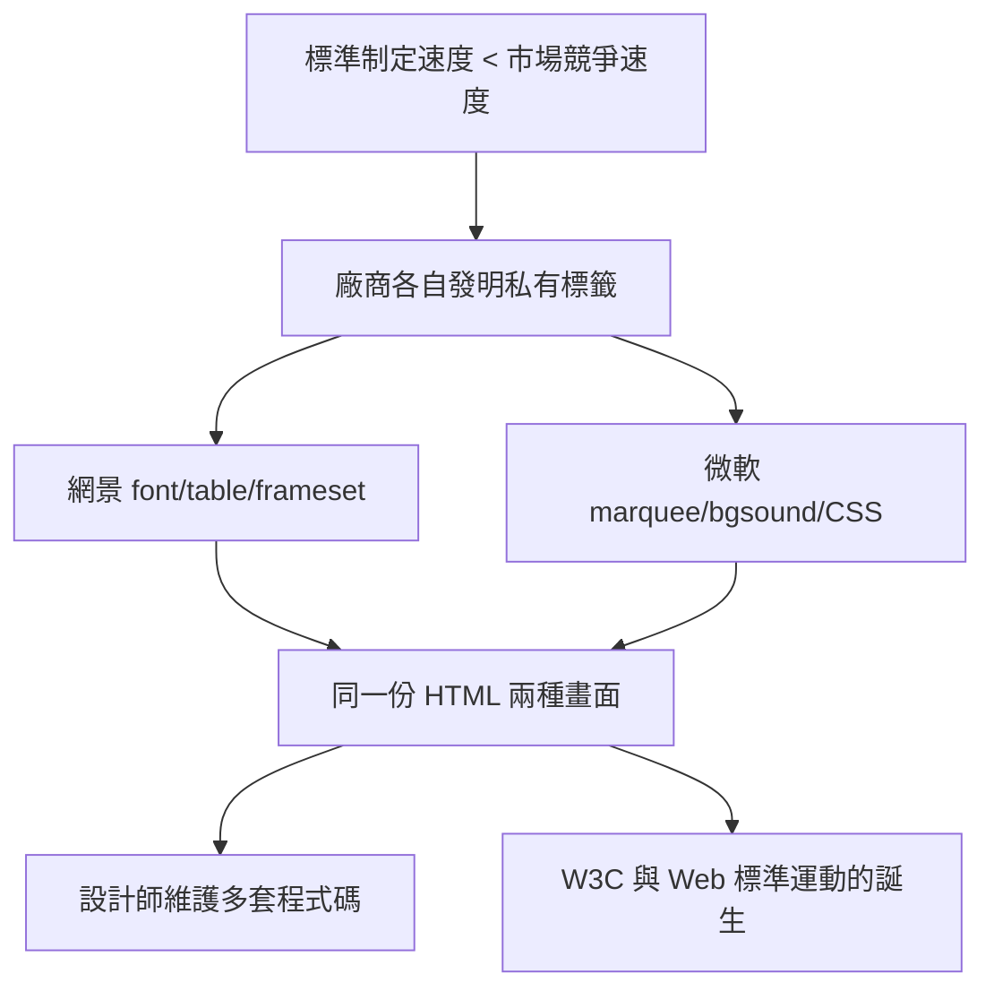

# 標籤大亂鬥：私有標籤與不相容的混亂初年

## 當標準落在市場後面

1990 年代中期，網頁技術出現了一個制度性的斷層：標準的制定速度遠遠落後於市場的競爭速度。HTML 的正式規範直到 1995 年 11 月（HTML 2.0，RFC 1866）才由 IETF 發布，而此時網景與微軟早已各自往前狂奔。既然官方標準追不上需求，廠商就自己發明標籤——這是瀏覽器戰爭的技術戰場。

網景先發制人：`` 讓網頁作者第一次能指定文字顏色與大小，`
` 能置中，`<table>` 從資料表格被挪用為排版工具，還有 Frameset 把視窗切成多個頁框。微軟 1995 年推出 IE 1.0 後奮起直追，推出了自己的擴充：`<marquee>` 跑馬燈、`<bgsound>` 背景音樂、CSS 的早期實作（IE 3 首度支援）。此外還有各種只在一家瀏覽器上有效的屬性。

結果是荒謬的：同一份 HTML，在 Navigator 上完美呈現的頁面，到了 IE 可能碎成一團，反之亦然。網頁設計師被迫學會「兩套寫法」，或在頁首加入腳本偵測瀏覽器、分流到不同版本的頁面。「Best viewed with Netscape Navigator」與「Best viewed with Internet Explorer」的小徽章，成為那個年代網站頁尾的時代印記。

## 使用者經驗的碎片化

對使用者而言，這個年代的上網體驗像地雷區：網頁載入到一半可能崩潰、外掛外掛又外掛（後見之明地說，外掛文化正是從這裏發芽）、錯誤的畫面層出不窮。對企業而言，架一個網站等於要維護兩套以上程式碼。技術債的利息，是整個產業在支付。

更深層的影響是制度性的：當廠商可以單方面定義標籤，「開放網路」的理想就淪為強者的戰利品。這段混亂直接催生了兩個補救機制。其一是 1994 年成立的 W3C，試圖用「共識程序」把廠商的發明收編為標準；其二是 1990 年代末 Web 標準計畫（Web Standards Project, WaSP）這類由設計師與開發者組成的倡議團體，向瀏覽器廠商施壓要求遵守規範。網頁設計師第一次意識到：自己的工作條件，取決於政治與遊說，而不只是美學與程式。

標籤大亂鬥的教訓，是網頁設計史的第一條定律：沒有共同的標準，設計自由只是強權的恩賜。而這條定律的完整代價，要到第一次瀏覽器大戰的血流成河之後，才真正被清算。
