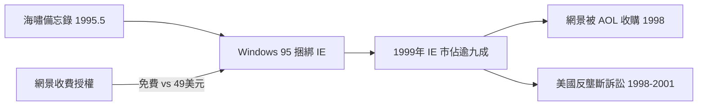

# Internet Tidal Wave 備忘錄與 IE 捆綁的降維打擊

## 1995 年 5 月 26 日的全公司動員令

1995 年 5 月 26 日，比爾·蓋茲向微軟全公司發出一封備忘錄，標題是《The Internet Tidal Wave》（網際網路海嘯）。他在信中把網際網路定位為「自 IBM PC 以來最重要的事」，並宣布微軟的所有產品計畫都要以網路為中心重新排序。這封信的分量在於它來自誰：當時微軟憑 Windows 3.1 與即將上市的 Windows 95，統治著全球 PC 作業系統市場，而蓋茲本人在此之前對網際網路反應遲緩。

改變他態度的觸媒有二。一是網景 IPO 在即，市場已把瀏覽器視為「下一個作業系統」——如果使用者都在瀏覽器裏工作，Windows 就淪為底層的驅動程式，微軟的平台霸權將被架空。二是內部工程師的反覆示警。海嘯備忘錄之後，微軟在數月內重組了整個開發優先級，IE 團隊急速擴編。

## 捆綁：殺傷半徑最大的商業武器

1995 年 8 月，Windows 95 上市的同一天，微軟推出了 Internet Explorer 1.0。真正的殺招在於分發模式：IE 免費、內建於 Windows，隨著每台新 PC 自動安裝。而網景 Navigator 的商業版要收 49 美元。

這是一場不對稱的戰爭。網景的收入幾乎全靠瀏覽器授權費；微軟的瀏覽器不必賺錢——它只需要存在。1996 年 IE 3.0 追近了技術差距（首度支援 CSS 與 ActiveX），1997 年 IE 4.0 把瀏覽器深度整合進桌面外殼。到 1998 年，IE 的市場份額已經逆轉超越 Navigator；到 1999 年，IE 拿下超過九成市場。

網景的反擊手段有限：降價、免費、轉向企業市場、加碼伺服器軟體。但使用者不會為一個「免費也能拿到」的產品付費。1998 年 11 月，在訴訟與虧損的雙重壓力下，網景被 AOL 以 42 億美元收購——18 個月前它還是華爾街的傳奇。

## 反壟斷訴訟：制度的最後回應

捆綁策略引來了美國司法部的反壟斷訴訟。1998 年 5 月，美國政府與二十個州起訴微軟非法利用作業系統壟斷地位打擊瀏覽器競爭對手。2000 年 4 月，聯邦地區法院法官傑克遜裁定微軟違反反壟斷法，判決其應被拆分；2001 年上訴法院確認了壟斷行為的認定，但推翻了拆分令，最終以和解收場——和解條款要求微軟不得報復裝了競爭瀏覽器的 PC 製造商。

訴訟晚了三年，網景已死。但這場官司在更廣的歷史尺度上影響重大：它讓資本與輿論重新審視平台壟斷，也讓 2000 年後的美國科技業對「捆綁」多了一分忌憚。而瀏覽器技術本身，在網景死後進入了長達十年的黑暗期——IE 6 統治著一個沒有競爭者的世界，這是後話。

一個用理想主義開創的技術，最終由兩個資本帝國用商業武器爭奪統治權。網景輸了戰爭，但它死前留下了兩份遺產：一份是開源的原始碼（見下節），一份是名為 JavaScript 的程式語言——日後整個前端世界都將跑在它之上。
