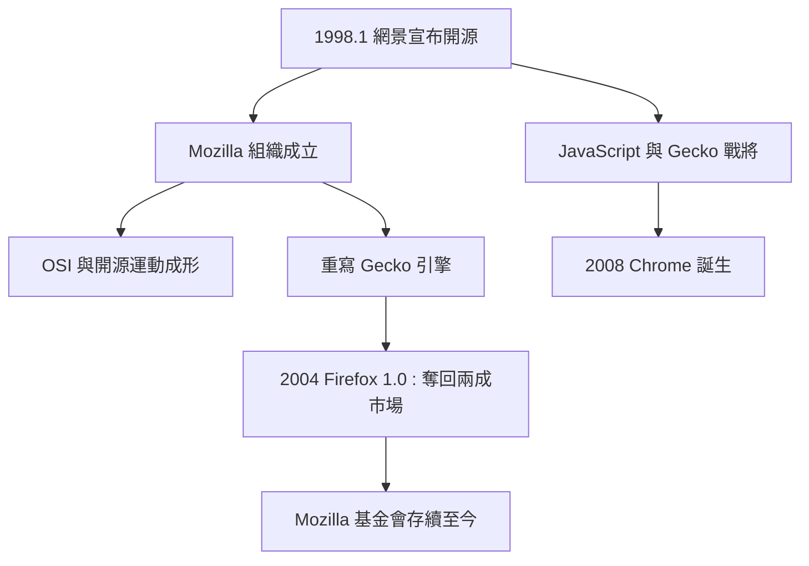

# 網景的悲壯反擊：開源原始碼化身 Mozilla

## 敗局中的豪賭

1997 到 1998 年，網景的市場份額一路崩落。IE 4.0 的技術水準已經追平甚至部分超越 Navigator，而微軟的分發機器（Windows 捆綁、OEM 合約）是網景無論如何都複製不了的。1998 年 1 月，網景做出了一個震驚業界的決定： Navigator 的原始碼全面開源，免費釋出給全世界。

這在當年是個極端舉動。一家上市公司把核心產品的原始碼公開，等於放棄了最後的商業壁壘。網景的逻辑是一場悲壯的豪賭：既然在商業上已無法與微軟的免費產品競爭，不如把戰場轉移到「開放」的道德高地，動員全球開發者共同改進瀏覽器，用社群的力量對抗微軟的資本力量。

## Mozilla 與開源運動的里程碑

1998 年 2 月，網景成立了 Mozilla 組織（mozilla.org）來管理這個開源專案，名字取自 Mosaic Killer 的綽號。同一年的春天，開放原始碼倡議（Open Source Initiative, OSI）成立，Eric Raymond 的《大教堂與市集》一書出版——「開源」作為一個有意識的商業與哲學運動，正是在網景開源的催化下成形的。歷史學者普遍認為，網景的決定是開源運動走向主流的關鍵事件：它證明了一家上市公司可以把未來押在社群協作上。

Mozilla 專案本身的路途卻相當坎坷。原始的 Navigator 程式碼經年累月、雜亂不堪，團隊最終決定幾乎全部重寫，開發全新的渲染引擎 Gecko。這個「全部重寫」的決定讓第一個 Mozilla 瀏覽器遲至 2002 年才達到可用狀態——而此時 IE 已統治市場四年，網頁設計師早已習慣「只為 IE 設計」。

Firefox 的救贖要再等兩年。2004 年 11 月，Mozilla 推出了輕量化的 Firefox 1.0，以標準相容、分頁瀏覽與安全性為賣點，奇蹟般地在 IE 6 的壟斷下奪回了兩成的市場份額。它證明了兩件事：瀏覽器市場不是天然壟斷，以及標準相容本身就是產品力。

## 商業結局與技術遺產

2003 年，AOL 關閉了網景部門；2008 年，AOL 停止開發網景瀏覽器。帝國正式落幕。但 Mozilla 基金會存續至今，Firefox 成為 Chromium 之外最重要的獨立瀏覽器引擎。

網景還留下了另外兩份遺產。其一是 JavaScript：1995 年網景工程師布蘭登·艾克（Brendan Eich）在十天內設計出這門語言，它是日後所有網頁互動的基礎。其二是 Gecko 引擎與SpiderMonkey——而 2008 年誕生的 Google Chrome，其創始工程團隊中就有多名前網景與 Firefox 戰將。瀏覽器戰爭的火種，就這樣從網景傳到 Mozilla，再傳到 Google。

一場戰爭的敗者，用開源改寫了軟體產業的制度史。這大概是網頁設計史上最悲壯、也最富有理想主義色彩的一章。
