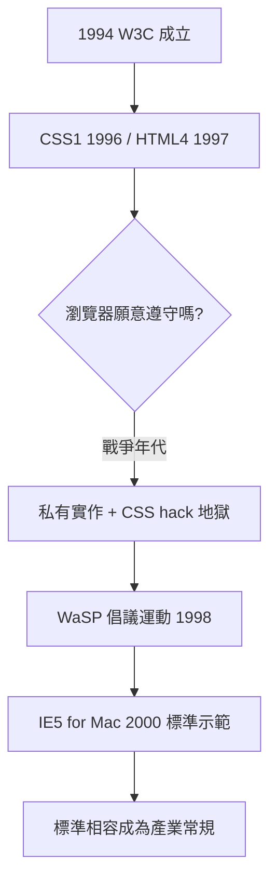

# W3C 的成立與標準化陣痛

## 用制度收拾戰場

1994 年 10 月，提姆·柏內茲-李離開 CERN，在麻省理工學院電腦科學實驗室創立了萬維網聯盟（World Wide Web Consortium, W3C）。創立的動機非常直接：瀏覽器大戰正在把網頁技術撕成碎片，必須有一個中立的機構來制定共同的規範，並且說服廠商——包括正在互相廝殺的網景與微軟——坐下來一起簽字。

W3C 的運作方式是獨特的「會員制共識」：成員包括蘋果、微軟、網景、IBM、昇陽等數百家公司，規範由工作小組起草、經過提案（Working Draft）、候選（Candidate）、建議（Recommendation）等階段逐層審議。柏內茲-李刻意讓 W3C 不做認證、不收權利金、不具有強制力——它的武器只有說服與共識。這個軟弱的外表日後被證明是它最大的制度困境，也是它得以存續的智慧。

早期的成果包括 1996 年的 CSS 1、1997 年的 HTML 3.2 與 HTML 4.0、1998 年的 CSS 2。這些規範試圖把網頁的「結構」與「外觀」分離：HTML 負責語意，CSS 負責樣式。這是網頁設計史上第一次，設計能力被明確設計成一個標準化的、獨立於瀏覽器廠商的體系。

## 陣痛：標準與現實的十年落差

問題在於，規範寫出來了，瀏覽器卻不想遵守。大戰期間，實作私有功能比實作標準更能贏得市場——「今天就能用的酷炫標籤」永遠勝過「明年才會通過的規範」。更糟的是，兩家廠商對同一條 CSS 規則的解釋都可能有出入，甚至 IE 還刻意保留了對舊版錯誤行為的相容（著名的「怪異模式」與「標準模式」切換，正是為了處理這個歷史包袱）。

結果是網頁設計師的地獄十年。一個網站要正常顯示，往往要為 IE 寫一套 CSS hack（例如利用 IE 解析錯誤的 `*html` 選擇器、`!important` 疊加），再為 Netscape 寫另一套。整個行業在標準與現實的夾縫中消耗了大量人力。

轉機來自產業內部的自我組織。1998 年，一群設計師與開發者組成了 Web Standards Project（WaSP），公開向瀏覽器廠商施壓。1999 到 2000 年間，WaSP 發起「Browser Upgrade Campaign」，倡導在網站中加入「請升級你的瀏覽器」提示，用市場壓力逼使用者遷移。真正的勝利來自 2000 年：微軟在 IE 5 for Mac（由接受標準理念的團隊開發）首度對 CSS 與 DOM 有高品質的實作，證明「遵守標準」在工程上可行。此後，標準相容才逐漸從道德訴求變成產業常規。

W3C 的故事告訴我們：技術標準從來不只是技術問題，而是產業政治問題。而它定下的「結構與外觀分離」原則，正是下一章的主角——CSS——的哲學核心。
