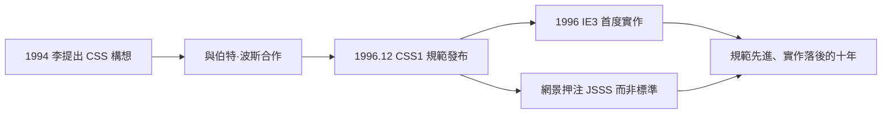

# 哈康·維姆·李與伯特·波斯：CSS 的瘋狂構想

## 一個挪威人的提案

1994 年，在 CERN 工作的挪威工程師哈康·維姆·李（Håkon Wium Lie）提出了層疊樣式表（Cascading Style Sheets, CSS）的構想。他觀察到 HTML 正在走上一條危險的路：``、`
` 之類的視覺標籤不斷增加，內容與外觀攪在一起。這樣走下去，HTML 會變成一個既不清晰、又無法長期維護的怪物——文件無法被機器正確解讀，作者無法統一改版，閱讀者也無法依自己的需求（例如大字版、語音朗讀）重新呈現內容。

李的想法是：把「長什麼樣」從 HTML 裏完全抽離，放到一張獨立的樣式表裏。作者可以寫樣式表，讀者也可以覆蓋樣式表（這就是「層疊」cascading 的由來——瀏覽器預設樣式、作者樣式、讀者樣式按優先順序疊加）。這是一個在當時相當激進的民主化設計：呈現方式不只是網站主人的權力，也是閱讀者的權力。

李在 1994 年 10 月於芝加哥舉行的網際網路會議上首次公開這個提案，並與荷蘭電腦科學家伯特·波斯（Bert Bos）合作。波斯當時正在格羅寧根大學開發自己的樣式系統（Argo），兩人發現彼此的想法高度契合，遂合併構思。1996 年 12 月，W3C 正式發布 CSS Level 1 規範，兩人共同署名。

## 為什麼需要「層疊」

CSS 的設計哲學可以濃縮成一個問題：當多個樣式來源衝突時，誰說了算？李與波斯的答案是層疊演算法：瀏覽器預設 < 讀者樣式 < 作者樣式，重要聲明（important）可以反向提升優先級。這個設計兼容了三方利益——瀏覽器需要合理的預設值、讀者需要無障礙的調整權、作者需要品牌的一致性。

這個哲學對網頁設計的意義是革命性的：設計師第一次可以「宣告」而不是「描述」——你不用再寫「把這段文字變紅、變大、換行」的指令，而是寫「所有段落用這種樣式」。宣告式的思維（describe, not command）日後滲透進了整個前端工程文化，從 CSS 到 React 的 JSX，都是這條思想線的延伸。

## IE 3 與早產的現實

CSS 的第一個主要實作，來自意外的一方。1996 年 8 月，微軟在 IE 3 中加入了對 CSS 的基本支援——部分歸功於當時在微軟工作的湯瑪斯·雷爾丹（Thomas Reardon）對標準的推動。網景則反應遲緩，寧願押注自己的 JavaScript 樣式方案（JSSS），直到 Navigator 4 才勉強支援部分 CSS，品質參差不齊。

歷史的諷刺在於：CSS 誕生後將近十年，設計師都無法真正「自由」地使用它——不是因為規範不好，而是因為瀏覽器實作殘缺不全。CSS 2（1998 年）規範中的絕對定位、浮動、層疊上下文等功能，要到 2000 年代中期 IE 7、Firefox、Safari 普及後才真正可用。「規範先進、實作落後」成為網頁技術的宿命循環。

一份改變設計師命運的規範誕生了，但它的使用者還要在表格排版的泥沼裏掙扎多年。下一節，我們來看看 CSS 普及之前，設計師是用什麼荒謬的手段在網頁上「排版」的。
