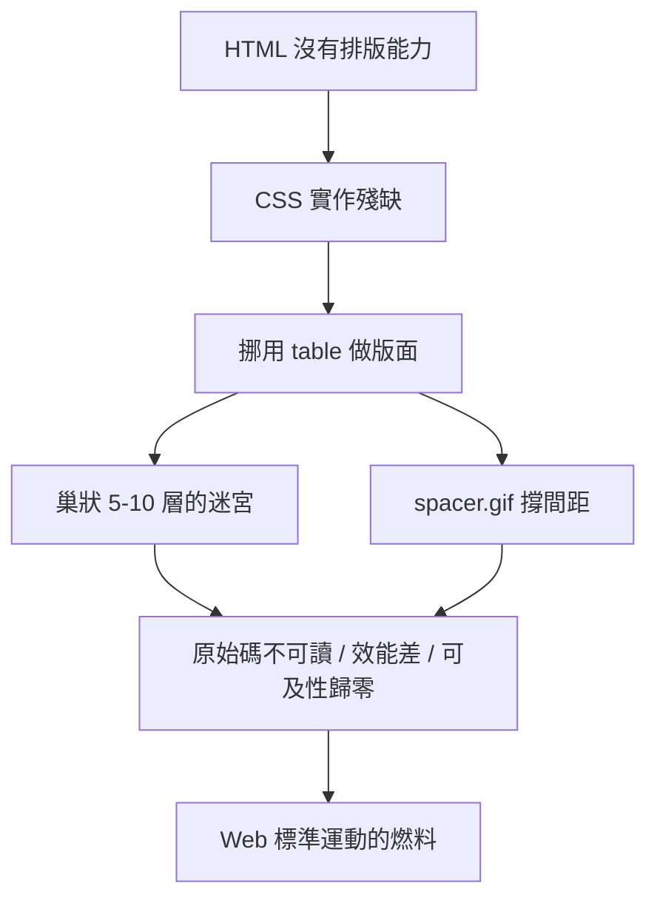

# 透明 GIF 與巢狀表格：排版惡夢的荒謬歲月

## 沒有排版工具的年代

1990 年代後期，HTML 的工作指標是「文檔」而非「版面」。它天生只會從上到下堆疊標題與段落，沒有欄、沒有絕對定位、沒有精確間距。但企業客戶上網了，他們的要求很明確：我的網頁要長得像我的平面廣告——左邊一欄導覽、右邊內容、上面橫幅、指定字型、指定顏色。

在那個 CSS 幾乎不可用的年代（IE 對 CSS 的支援破碎，Netscape 4 更差），設計師只能從現有工具中「挪用」兩樣東西來硬湊排版：表格（table）與透明圖片。

## 表格排版：資料工具的百年酷刑

`<table>` 本來是為呈現資料表格設計的，但它有個致命的吸引力：可以精確控制格子的寬度與相對位置。設計師於是把整個頁面塞進一張表格，用 colspan 與 rowspan 拼出版面結構，導覽欄是一格、內容是一格、頁尾是一格。為了逼出細節，他們把表格巢狀再巢狀——表格裏有表格，五層、八層、十幾層的巢狀司空見慣。

代價是慘烈的。第一，原始碼變成不可讀的迷宮，維護一份改版需要重排整座巢狀迷宮。第二，效能災難：瀏覽器必須讀完整張表格才能決定版面，使用者得盯著空白頁面等待，撥接年代一個複雜首頁要數十秒。第三，可及性歸零：螢幕閱讀器把版面表格當成資料表格朗讀，視障者聽到的是一場災難。第四，語意死亡：HTML 完全失去結構意義，搜尋引擎也難以解析。

## 透明 GIF：史上最蠢的魔法

與表格搭配的，是 Spacer GIF（間距圖）技法：一張 1x1 像素的透明 GIF 圖片，被放大、拉寬、塞進格子裏，用來撐出空隙、固定間距、墊高高度。設計師的素材庫裏都存著一張 `spacer.gif`，然後在原始碼裏寫下數十個 ``。

這個技法的荒謬之處在於：它把「留白」這個排版基本元素，用一張看不見的圖片來模擬。整個產業都在用騙術對抗工具的缺陷。1997 年前後出版的網頁設計教學書，幾乎都用整整一章教讀者怎麼用表格加 spacer.gif 做出「專業版面」——這段歷史是理解後來 Web 標準運動為何如此激昂的鑰匙：人們真的受夠了。

諷刺的是，這段泥沼歲月也催生了網頁設計師作為一個職業的自我意識——正因為工具如此爛，把爛工具用出花樣的人被視為英雄。而當 2003 年 CSS 禪意花園登場時，整個設計界才恍然大悟：原來另一條路一直都在。
