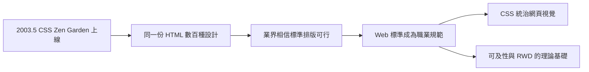

# CSS 禪意花園：一份 HTML 無限美學的震撼彈

## 一場證明題

2003 年 5 月，加拿大設計師戴夫·謝伊（Dave Shea）上線了一個網站：CSS Zen Garden（CSS 禪意花園）。它的規則簡單到近乎禪宗公案：一份固定的 HTML，任何人不得更動一個字元；參賽者只能提交自己的 CSS 檔與圖片素材，去重新設計整個頁面。

謝伊的動機是一場論戰的證明題。當時業界仍有大量聲音認為「表格排版就是比較快、比較穩，CSS 排版是學院派的空想」。禪意花園就是要用最直觀的方式反駁：看看同一份 HTML 能變出多少種截然不同的臉孔。上線後的幾個月內，數百個設計師提交作品——有的極簡、有的華麗、有的復古報紙風、有的賽博龐克——而它們全部共享同一份 HTML 原始碼。設計界被震動了。

## 標準運動的凱旋儀式

禪意花園的意義遠超一個設計比賽。它把抽象的「Web 標準」理念，轉譯成了設計師看得見、老闆看得懂的視覺語言。同年，謝伊與傑佛瑞·澤爾德曼（Jeffrey Zeldman）等人的著作陸續出版，把「語意化 HTML + 外部 CSS + 標準 DOM」的工作方法包裝成一套職業規範。澤爾德曼 2003 年的《Designing with Web Standards》成為行業聖經，口號「遵守標準，不是為了道德，而是為了省錢」說服了企業客戶。

從此，網頁設計師的工作流程發生了根本重構：先寫語意結構，再套樣式；版面與內容分離；一套 HTML 服務多種裝置（日後 RWD 的理論基礎在此打下）；可及性從附加品變成規格。2000 年代中期，表格排版退入歷史，CSS 成為網頁視覺的統治者。

這場勝利還有一個制度面意義：它證明了設計社群可以推動技術政策。WaSP、禪意花園、A List Apart 雜誌構成了一個由從業者主導的公共輿論場，迫使瀏覽器廠商把標準相容當成產品需求。這是網頁設計師第一次以集體身分，改變了自己使用的工具。

## 禪意花園的哲學餘韻

禪意花園的口號——「The beauty of CSS design」——日後演化為一種設計倫理：內容與呈現的分離，本質上是對內容的尊重。同一份文章，應該能在桌機、手機、螢幕閱讀器、搜尋引擎上各自以最適的方式存在。這個理念在二十年後的今天以另一種形式回歸：Headless CMS 把內容做成 API，前端只是眾多「呈現層」之一；RWD 讓一份內容適應所有螢幕。結構與表現分離的思想，貫穿了整個網頁史。

然而就在 CSS 陣營歡慶勝利的年代，網頁視覺的另一場狂歡正在另一個世界進行。那個世界的居民不用 HTML，他們用一個叫 Flash 的外掛，把整個瀏覽器變成了動畫舞台。
