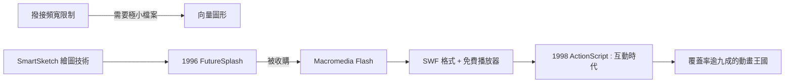

# 從 FutureSplash 到 Flash：向量動畫的革命

## 撥接世代的動畫難題

1990 年代中期的網頁有一個硬傷：太慢。撥接數據機的速度是每秒 28.8K 到 56K 位元，一張未壓縮的點陣圖要下載數十秒，而動畫如果用 GIF 逐格播放，檔案更是災難。要在網頁上做動畫，必須解決一個數學問題：如何用最小的檔案描述最豐富的畫面？

答案是向量圖形。點陣圖記錄每一個像素的顏色；向量圖只記錄「畫什麼」的指令——一條曲線的控制點、一個填色的形狀、一段補間動畫的起點與終點。同一個動畫，向量檔案可能只有點陣圖的百分之一。瀏覽器端的播放器收到指令後，即時運算出畫面。

## FutureSplash 的誕生與改名

這條路線的實現者是 Jonathan Gay 等人。他們的公司先做了平板繪圖硬體 SmartSketch，隨後在 1996 年把繪圖技術轉向網頁動畫工具，命名為 FutureSplash Animator。1996 年 8 月，宏利公司（Macromedia，當時多媒體工具的霸主，擁有 Director 與 Authorware）看準了這個產品，將其收購，改名為 Macromedia Flash 1.0。

Flash 的組成是三位一體：一套讓設計師用時間軸畫動畫的編輯器、一個向量動畫格式（SWF）、以及一個瀏覽器外掛（Player）。這個組合命中了所有的痛點：設計師不用寫程式就能做動畫、檔案極小、播放器一次安裝終身免費。到 1990 年代末，Flash Player 已內建於 Windows 與各大瀏覽器，覆蓋率超過九成——它成了網路上事實上的動畫作業系統。

1998 年後 Flash 加入了 ActionScript 腳本語言，從「會動的圖」升級為「可以互動的應用」：按鈕有反應、遊戲可以玩、選單可以滑出。網頁第一次擁有了超越「文件」的能力。

## 一個獨立王國的興起

從技術哲學看，Flash 是對「開放網頁」的背叛：SWF 是私有格式，內容被封在二進位檔裏，搜尋引擎讀不到、螢幕閱讀器碰不到、原始碼不可見。但對 1990 年代末的設計師而言，這個「背叛」恰恰是解放——它繞過了 HTML/CSS 的所有限制，繞過了瀏覽器相容性地獄，提供了一個「所見即所得」的統一畫布。一個世代的設計師是在 Flash 上學會動畫與互動的。

Flash 給了設計師前所未有的自由，而這種自由將在接下來的黃金十年裏，把網頁視覺推向「拒絕無聊」的極端——同時也種下了它自己的死刑判決書。
