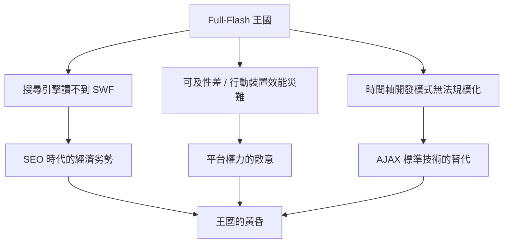

# Full-Flash 黃金時代：酷炫卻對搜尋引擎不友善的視覺孤島

## 拋棄 HTML 的十年

1990 年代末到 2000 年代中期，是所謂 Full-Flash 網站的黃金年代。一批設計公司與品牌官網乾脆完全拋棄 HTML：整個網站是一個 SWF 檔，進站先播一段動畫開場（往往配有「Skip Intro」按鈕），進入後是一個充滿滑鼠感應、飛入轉場、向量插畫與背景音樂的沉浸式空間。2advanced、whoswe 等工作室的作品被奉為神級教材，設計論壇上流傳著「這個網站是 Flash 做的嗎」的朝聖式讚嘆。

這個時代的視覺語言至今仍能辨識：實驗性的字體排印、向量的金屬光澤介面、噪點紋理、斜線切割的版面、搭配 Lo-fi 電子樂的片頭動畫。它源自平面的「視覺傳達」傳統，而不是工程傳統——Flash 編輯器的時間軸與圖層，本質上就是動畫師的工作檯。網頁設計史上第一次，設計師可以完全不碰程式碼而擁有整個網站。

## 王國的三根裂縫

但 Full-Flash 王國的基石上有三道裂縫，隨著時間越裂越深。

第一道是搜尋引擎。SWF 是私有二進位格式，Google 的爬蟲讀不到裏面的文字與連結。一個 Full-Flash 網站在搜尋引擎眼裏等於不存在。2000 年代中期，搜尋成為網路流量的最大入口，SEO 成為企業的生死線——你做得再美，搜不到就沒有客人。視覺孤島的經濟代價開始被量化。

第二道是可及性與裝置。螢幕閱讀器無法朗讀 Flash 內容，視障使用者被排除在外；行動裝置上的 Flash 效能奇差、耗電驚人；使用者也無法複製文字、無法用瀏覽器的返回鍵返回上一頁（Flash 內部導航對瀏覽器是隱形的）——這些「小小的麻煩」累積成平台性的劣勢。

第三道是開發模式。Flash 專案由單一設計師用時間軸製作，難以版本控制、難以分工、難以維護。當網站從「宣傳品」變成「應用程式」（社交網路、購物車、電子郵件），時間軸工具的產能天花板就到了。同期，AJAX 證明了 HTML+JavaScript 也能做出流暢互動，企業逐漸發現：標準技術更便宜、更好維護、還能被搜尋。

值得記住的是，Flash 時代並非全然的歧路：它提前示範了互動設計的眾多範式——補間動畫、狀態轉場、沉浸式敘事——這些概念在 HTML5 時代以 Canvas、WebGL、CSS animation 的形式復活。Flash 死了，但它的美學遺產被後繼者繼承。而執行死刑的那份判決書，來自一個不賣電腦的人：史帝夫·賈伯斯。
