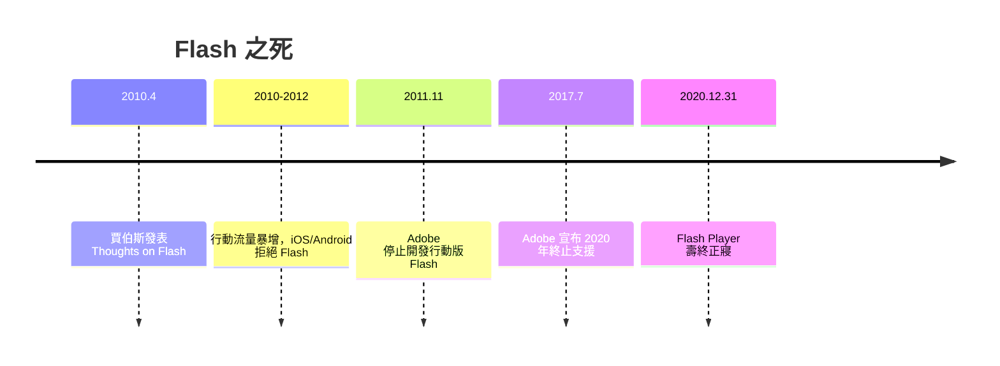

# 喬布斯的公開信：2010 年封殺 Flash 的歷史判決

## 一封判決書

2010 年 4 月 29 日，蘋果公司官網刊登了一封信，標題〈Thoughts on Flash〉，署名史帝夫·賈伯斯。當時 iPhone 已上市三年，Adobe 一直在公開抱怨蘋果拒絕讓 Flash Player 進入 iOS。這封信是賈伯斯對全世界的一次正式答覆，也是一紙技術判決書。

信中的理由有六條。第一，Flash 是封閉的私有技術，由 Adobe 獨家控制，而 HTML5、CSS 與 JavaScript 才是開放的網頁標準。第二，iOS 上的 H.264 影片播放不需要 Flash，YouTube 與 Vimeo 都已提供 HTML5 播放。第三，Flash 帶來安全性問題（信中提到 Symantec 的報告將 Flash 列為 2009 年最嚴重的資安漏洞來源之一）。第四，Flash 續航力差，會拖垮 iPhone 的電池時間。第五，Flash 為桌機與滑鼠設計，不適合觸控螢幕。第六，也是最根本的一條：允許一個第三方執行環境在 App 之外建立平台層，會妨礙蘋果的品質管控——App Store 模式的商業利益在此赤裸上陣。

## 一個時代的終結

這封信的效果立竿見影。行動流量在 2010 年後暴增，而 iOS（以及追隨其後的 Android 陣營）不支持 Flash，意味著新世代的數億使用者根本看不到 Flash 內容。廣告主、媒體、品牌被迫全面改用 HTML5。2011 年 11 月，Adobe 宣布停止開發行動版 Flash Player；2012 年 8 月，Adobe 宣布 YouTube 等大客戶轉向 HTML5；2017 年 7 月，Adobe 正式宣布 2020 年底終止 Flash Player 支援。2020 年 12 月 31 日，Flash 時代正式落幕。

這是網頁設計史上最戲劇性的平台權力展示：一家手機公司，用一份公開信與一部手機的市場佔有率，終結了一個統治網頁視覺十五年的技術王國。判決的依據不完全是技術優劣—— Flash 在桌機上仍然運作良好——而是行動時代的權力結構改變了：誰控制裝置，誰就控制網頁的未來。

## 灰燼中的遺產

Flash 的死亡也是一次視覺文化的轉移。時間軸動畫師、互動設計師這個職業群被迫遷徙到新的土地上：HTML5 Canvas、CSS animation、JavaScript 動畫庫（GreenSock 最初就是 Flash 社群的產物）、以及後來的 WebGL。綠襪子（GreenSock）、CreateJS 等工具的作者幾乎全部來自 Flash 界。Adobe 自己也把 Flash Professional 改名為 Animate CC，改輸出 HTML5 Canvas。

更深遠的是制度層面的意義：賈伯斯信中把「開放標準」作為主要論據，即便動機是商業的，這份文件客觀上加速了 HTML5 標準的普及，也讓「無外掛的網頁」（No-Plugin Web）成為產業共識。今天我們能在瀏覽器裏原生播放影片、跑 3D、玩遊戲，正是從這次「清理門戶」開始的。

外掛時代結束了，網頁回到三個字母的統治之下：HTML、CSS、JavaScript。而這三者的下一次革命——告別「點擊就重新整理」——將由一篇文章與一張地圖點燃。
