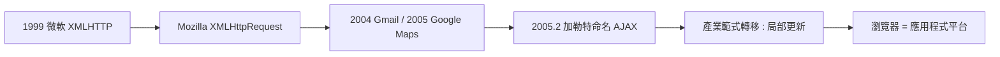

# 2005 年命名 AJAX：一篇短文點燃的非同步革命

## 一個造詞的誕生

2005 年 2 月 18 日，美國資訊架構師傑西·詹姆斯·加勒特（Jesse James Garrett）在他的公司 Adaptive Path 的部落格上發表了一篇短文，標題是〈Ajax: A New Approach to Web Applications〉。文章提出了一個新詞：AJAX，Asynchronous JavaScript and XML（非同步的 JavaScript 與 XML）。

加勒特並沒有發明任何新技術。他做的事是命名與整合論述：他指出，Google Suggest、Gmail 等新一代網頁應用，共同使用了一組其實早已存在的技術組合——用 XMLHttpRequest 在背景向伺服器要資料、用 JavaScript 更新頁面局部、用 DOM 呈現結果、用 XML（或純文字）傳輸——全程不必重新整理頁面。他把這個組合命名為 AJAX，並斷言這代表著「從網頁頁面到網頁應用」的範式轉移。

這篇文字的傳播是教科書級的：一個精準的行銷式造詞（後來連 XML 都被 JSON 淘汰了，但 AJAX 這個詞留了下來），一個清晰的概念包裝，加上恰好兩個現象級產品（Gmail、Google Maps）作為證據。幾個月內，AJAX 成為整個產業的通行語。

## XMLHttpRequest：藏了七年的武器

AJAX 的核心技術 XMLHttpRequest 其實在 1999 年就已出現：微軟的 Outlook Web Access 團隊為了讓網頁版郵件不刷新就收信，在 IE 5 的 MSXML 函式庫中實作了 XMLHTTP ActiveX 物件。Mozilla 後來照抄了介面，實作為 XMLHttpRequest。換言之，這把武器在庫房裏躺了六年，直到 Google 的工程師在 Gmail（2004）與 Google Maps（2005）中大規模使用，加勒特再給它一個名字，它才成為公眾知識。

這段歷史再次印證了網頁技術的傳播規律：技術的存在不等於技術的普及。命名、示範產品與論述整合，缺一不可。

## 為什麼「不刷新」如此重要

在 AJAX 之前，網頁的基本互動模式是「請求—回應—整頁重建」：你按一個按鈕，瀏覽器把整個頁面丟掉，向伺服器要一份新的，重新下載、重新渲染。這個模式有可感知的延遲、有閃爍、有捲動位置丟失、有表單狀態清空。而 AJAX 讓「部分更新」成為可能：資料來回於背景，畫面只有局部變化。

這不只是效能改善，而是互動性質的改變。刷新模式的網頁像翻閱報紙，AJAX 模式的網頁像操作一台機器——它對輸入即時反應。桌面軟體般的體驗第一次在瀏覽器裏成為可能。因此加勒特說 AJAX 是「Web 應用」的方法論，而不是「網頁」的技巧：它把瀏覽器從文件閱讀器升級為應用程式平台。

AJAX 的時代宣告了「點擊就刷新」的死刑，也宣告了前端工程師的誕生——從此，寫 JavaScript 不再是點綴，而是網頁應用的核心。而點燃這一切的引信，是下一節的主角：一張可以無限拖曳的地圖。
