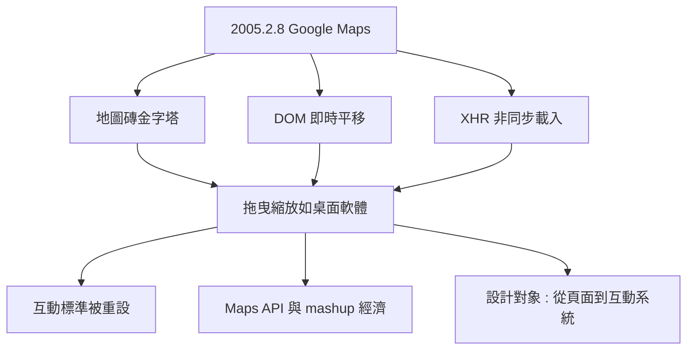

# Google Maps 震撼橫空出世：不必刷新的流暢地圖

## 2005 年 2 月 8 日的地震

2005 年 2 月 8 日，Google 發布了 Google Maps。十天後，加勒特發表了他的 AJAX 文章——地圖正是他文章中最重要的證據。這個時間順序本身就是歷史：產品先示範了可能，論述再為它命名。

在 Google Maps 之前，網路地圖的標準做法（MapQuest、Yahoo Maps 等）是「地圖磚 + 表單」：你要拖曳地圖，就得點一個方向按鈕，伺服器重算、整頁刷新、畫面閃爍、等待數秒。而 Google Maps 的體驗是：按住滑鼠，直接拖，地圖跟著手走；滾輪一滾，平滑縮放。沒有刷新、沒有閃爍、沒有等待。2005 年的使用者第一次在瀏覽器裏感受到「這怎麼可能是網頁」。

## 拆解魔法：三項關鍵技術

Google Maps 的魔法可以被拆解為三項技術的組合。

第一是地圖磚（tile）系統。整個世界地圖被預先切成數千萬張 256x256 像素的小圖，按縮放層級組織成金字塔結構。你拖曳時，瀏覽器只需下載可視範圍內的幾十張小圖，而不是一張巨型地圖。

第二是 DOM 操作。地圖磚是 `` 元素，被放在一個可以自由平移的容器裏；拖曳就是移動容器，邊緣的空白再動態補上下載好的新磚。這種「把元素當物理物件操作」的思維，是 DOM 技術的成熟標誌。

第三當然是 XMLHttpRequest：非同步抓取地圖磚、非同步抓取搜尋結果與路徑資料，使用者介面永遠不阻塞。

有趣的是，Google Maps 並非純 AJAX——它用了不少藏在後台的技術（例如用 iframe 與隱藏表單解決早期瀏覽器的限制，IE 上用 `decodeURIComponent` 處理圖磚載入等工程技巧），甚至有說法指出早期版本某些通訊用了隱藏 iframe 而非 XHR。但沒有人在乎實作細節：大家記住的是體驗。體驗本身成為技術的代言。

## 生態的連鎖反應

Google Maps 的衝擊是三層的。第一層，互動標準被重設：所有網路地圖服務被迫重寫，幾個月內 Yahoo Maps、微軟 Virtual Earth 都端出了拖曳版。第二層，API 經濟誕生：Google 隨後開放 Maps API，無數網站把地圖嵌進自己的服務，房產、餐廳、外送——地理資訊成了網頁的公共基礎設施，這也是「混搭（mashup）」文化的元年。第三層，也是最重要的：它證明了瀏覽器可以承載桌面級應用。Google Docs（2006）、Google Earth 外掛、乃至日後整個 SaaS 產業，都建立在這個證明之上。

對網頁設計師而言，Google Maps 改變了職業的定義：設計的對象從「頁面」變成了「互動系統」。狀態、回饋、即時性成為設計詞彙；「介面設計」與「互動設計」的份量第一次壓過了「版面設計」。UI/UX 作為一門顯學的興起，這張地圖是重要的推手之一。

非同步革命需要的最後一塊拼圖，是讓千萬普通設計師也能方便地使用它。兩年後，一個 22 歲的美國年輕人將用一句 `$()` 完成這件事。
