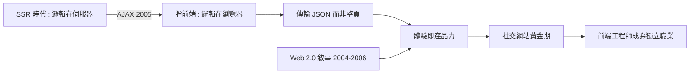

# 範式轉移：從伺服器渲染到非同步互動與 Web 2.0 黎明

## 兩種架構的斷代史

網頁應用的架構史，可以用 2005 年畫一條線。線之前，是伺服器端渲染（SSR）的時代：PHP、JSP、ASP 在伺服器上把 HTML 拼好，瀏覽器只是顯示器。邏輯在伺服器，狀態在伺服器，會話靠 Cookie。線之後，是「胖前端」的時代：JavaScript 在瀏覽器裏管理狀態、渲染局部、與 API 通訊。程式碼的重心，第一次從伺服器機房搬到了使用者的瀏覽器。

這個轉移的驅動力是經濟的。刷新模式每個互動都要伺服器重算重傳整頁，用戶越多伺服器成本越高；AJAX 模式傳輸的是輕量資料（後來是 JSON），伺服器只需提供 API。更關鍵的是體驗經濟的抬頭：Web 2.0 時代的競爭不在「有沒有網站」，而在「好不好用」。Gmail 用非同步證明了網頁郵件可以打敗桌面軟體，社交網站用即時更新證明了黏著度可以買到——體驗就是產品力，產品力就是估值。

## Web 2.0：一場命名與一場革命

2004 年，O'Reilly 媒體的戴爾·多爾蒂（Dale Dougherty）與提姆·奧萊利（Tim O'Reilly）構思了「Web 2.0」一詞，2004 年 10 月第一屆 Web 2.0 會議召開。它指的不只是技術，而是一整套結構轉變：使用者生成內容（部落格、Wiki、Flickr）、集體智慧（標籤、推薦）、以及「平台即服務」——網站不再是出版物，而是人人可參與的系統。

技術上，Web 2.0 的標配正是 AJAX。Flickr 的即時照片流、Digg 的無刷新投票、YouTube 的內嵌播放器，背後都是同一套技術。2006 年 8 月，O'Reilly 發表〈What Is Web 2.0〉，把 AJAX 列為 Web 2.0 的核心技術之一。命名運動再次展示了它在科技史上的力量：一個詞彙讓零散的現象獲得身分，讓資本獲得敘事，讓從業者獲得職業自信。

## 社交網站的黃金黎明與職業重構

2004 到 2008 年，Facebook 開放註冊、YouTube 誕生、Twitter 上線——社交網路成為網路的中心。這些產品全部是非同步互動的重度使用者：動態消息的即時更新、按讚的瞬間回饋、無限捲動的資訊流。每一個功能都在獎勵前端工程師的技術。

職業結構隨之重構。新的角色出現了：專職的前端工程師（而非「順便寫 JS 的後端」）、互動設計師、前端架構師。工具鏈開始成形：Firebug（2006，第一個強大的網頁除錯工具）、各種 JavaScript 函式庫、版本控制與協作流程。大學與培訓機構開始開設「前端開發」課程——這個名稱本身就是 2000 年代中期的發明。

非同步革命完成了架構的斷代。但要把非同步互動交給千萬設計師，還需要一件武器：一個讓 JavaScript 變得人人可用的函式庫。下一章的主角，是約翰·雷西格與 jQuery。
