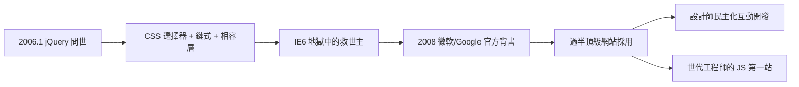

# 2006 年 John Resig 推出 jQuery：一句撫平相容性地獄

## 一個大學老師的副業

2005 到 2006 年之交，紐約羅徹斯特理工學院的一位年輕教師約翰·雷西格（John Resig）在做一個副業專案。他本來想寫一個叫 Selectors 的程式庫，後來意識到真正的問題更根本：瀏覽器的 DOM API 太破碎了。2006 年 1 月，他在部落格上發布了 jQuery 的第一個預覽版，原名一直演變到今天的名字。

雷西格的洞察是把三件事濃縮成一個 API。第一，選擇器（selector）：用 CSS 語法選取元素——`$(".box")` 選出所有 class 為 box 的元素，比瀏覽器原生的 `getElementById`、`getElementsByTagName` 靈活百倍。第二，鏈式呼叫（chaining）：`$(x).css().animate().fadeIn()` 一路寫下去，把對同一批元素的一連串操作接成一個句子。第三，隱匿相容性：所有跨瀏覽器的差異都被庫內部吸收，設計師永遠只面對一套乾淨的 API。

對 2006 年的設計師而言，這三件事的組合近乎魔法。當時要寫個淡入效果，你得先偵測瀏覽器（是 IE 還是 Firefox？是哪個版本？），再分別處理 opacity 的不同寫法、事件模型的不同綁定方式。jQuery 把這一切壓縮成一句 `$(".box").fadeIn()。` 這就是口號「Write Less, Do More」的字面意義。

## IE6 時代的救世主

要理解 jQuery 為何席捲世界，必須記得它面對的敵人有多可怕。2006 年，IE 6 佔有全球瀏覽器市場的大半，這個 2001 年發布的瀏覽器充滿了與標準相悖的實作：事件模型不同、透明度要靠濾鏡、盒模型算錯、Ajax 物件叫 ActiveX。任何 JavaScript 都要為 IE 6 開小灶。企業內網甚至鎖定 IE 6 十年不升級。

jQuery 的相容性層讓設計師得以假裝 IE 6 不存在。加上它只有幾十 KB、不依賴伺服器、純前端引入——對共享主機上的中小網站而言零門檻。傳播是病毒式的：設計師在論壇上看到一個炫效果，發現實作只需三行 jQuery，立刻複製走人。

2006 到 2012 年，jQuery 的採用曲線堪稱陡峭：2008 年 Google 把 jQuery 放進 CDN 加速服務；微軟與 Nokia 在 2008 年宣布官方支援；2012 年前後的統計顯示，全球過半的頂級網站在使用它。它成為有史以來最普及的 JavaScript 函式庫——某種意義上也是普及度最高的程式碼。

## 歷史定位：民主化的函式庫

jQuery 的歷史意義可以概括為民主化。在它之前，網頁互動是工程師的領域；在它之後，任何會一點 CSS 的設計師都能做出互動效果。大量日後成為前端工程師的人，職業起點就是 jQuery——它是一整個世代 JavaScript 學習者的第一站。

雷西格本人在 2011 年卸任 jQuery 專案負責人，加入 Khan Academy。而 jQuery 這個專案，則見證了自己被原生瀏覽器 API 逐漸吸收的命運：`querySelectorAll`、`classList`、`fetch`——2010 年代後期的瀏覽器把 jQuery 發明的便利一一內建。「最好的函式庫的命運，是讓自己變得不再必要。」

一句 `$()` 撫平了一個時代的地獄。而支撐這句魔法的生態系——那些讓設計師一裝就用的外掛——是下一節的故事。
