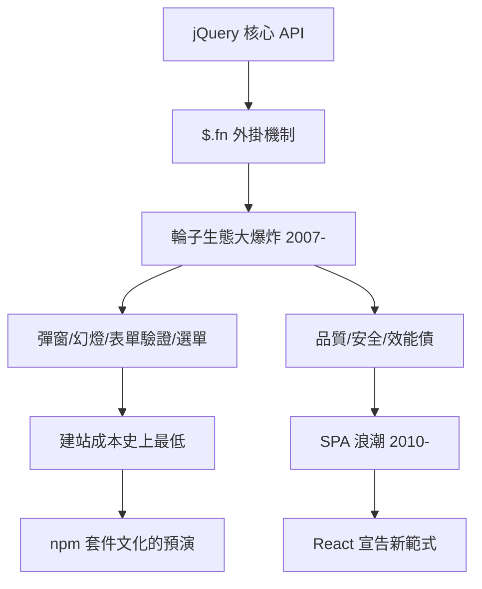

# Write Less, Do More：外掛生態的大爆炸

## 輪子不再重造

jQuery 的原生命令雖然強大，真正讓它統治世界的，是外掛（plugin）生態。jQuery 的架構天生適合擴充：任何開發者都可以寫一個 `$.fn.xxx` 函式掛進去，立刻擁有與原生方法一樣的鏈式語法。於是從 2007 年起，一個自組織的生態系爆炸了。

彈窗（Lightbox）、圖片幻燈片（Cycle、FlexSlider）、表單驗證（Validate）、下拉選單（Superfish）、日期選擇器（Datepicker）、自動完成（Autocomplete）、浮動導覽、視差捲動——每一個常見的網頁互動，都有現成的外掛，下載、引用一行 `<script>`、加一個 class，就能用。設計師的工作流程變成了「找輪子、裝輪子、調參數」。

這個生態的經濟效應不可低估。中小企業網站、作品集、活動頁的成本被壓到史上最低；WordPress 等內容管理系統大量內建 jQuery，把它送進了全球數千萬個網站；外包市場上「會 jQuery」成為接案的基本技能。2008 年後出版的網頁設計書籍，幾乎人手一章 jQuery——它就是那個年代的「標準配備」。

## 外掛文化的雙面性

外掛生態也有其陰影。第一是品質參差：外掛由全球素人不明的作者上傳，相容性與安全漏洞層出不窮，一個網站掛十幾個外掛，衝突與全域變數污染司空見慣。第二是效能債：每個外掛都載入整份函式庫，頁面動輒拖著數百 KB 的腳本，行動裝置時代開始顯得臃腫。第三是技能表層化：大量從業者只會「呼叫外掛」而不理解底層 DOM，這批人在 jQuery 退潮時需要痛苦的再學習。

但從更大的尺度看，外掛文化是 npm 模組宇宙的預演。它確立了幾條日後成為現代前端鐵律的觀念：程式碼應該封裝成可重用的單元；生態比工具本身更重要；遇到問題先找現成的套件，而不是重造輪子。2010 年 npm 誕生時，jQuery 世代的開發者不需要被說服「套件管理」的價值——他們早就活在套件文化裏了。

## 生態的頂點與轉折

2010 到 2013 年是 jQuery 生態的頂點：官方 UI 庫、行動版 jQuery Mobile、以及各種「jQuery 教學」橫掃書店。但轉折也在醞釀。2010 年前後，單頁應用（SPA）的浪潮興起：應用規模大到「資料—畫面」的同步靠手動操作 DOM 已經不可維護，工程師開始渴望宣告式的介面框架。Backbone（2010）、Angular（2010）、Ember（2011）相繼出現，它們不與 jQuery 爭奪「特效」市場，而是爭奪「架構」話語權——jQuery 管「怎麼動」，框架管「畫面從哪來」。

最終，React（2013）用虛擬 DOM 給出了新答案，宣告「直接操作 DOM」這個 jQuery 的核心範式走向黃昏。2010 年代中期，新專案漸漸不再以 jQuery 為基礎；而瀏覽器原生 API 也吸收了它的精華。到 2019 年，WordPress 以外的 jQuery 使用率持續下滑，但它的語法遺產——選擇器思維、鏈式、宣告式動畫——早已融入每一個開發者的肌肉記憶。

外掛生態的黃金時代教會了產業一件事：開發的未來不在單一工具，而在生態網路。而 jQuery 本身，則把一套思維方式永久地植入了一個世代的腦中——這是下一節要談的遺產。
