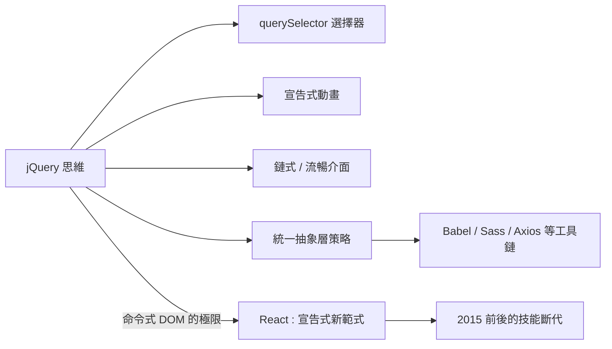

# 從外掛驅動到原生 DOM 封裝：思維方式的深遠植入

## jQuery 之後，世界長什麼樣

評估一項技術的影響，最好的量尺是它消失後留下的形狀。jQuery 逐漸退場之後，我們可以在今天的前端世界裏處處看到它的遺產。

第一是選擇器思維。`querySelector`、`querySelectorAll` 直接借用了 CSS/jQuery 的選擇器語法。今天的開發者用 `document.querySelector(".item")` 時，其實是在說 jQuery 的方言——這套「用 CSS 描述你要抓的元素」的心智模型，就是 jQuery 普及之後成為直覺的。

第二是宣告式動畫。CSS transition 與 animation 的普及、以及後來 Web Animations API 的設計，都繼承了 jQuery 的觀念：動畫應該宣告「從什麼到什麼、多久、什麼節奏」，而不是手動逐幀算位置。jQuery 的 `.animate()` 是這種宣告式動畫在 JavaScript 中的原型。

第三是鏈式與流暢介面（fluent interface）。從 jQuery 的鏈式呼叫，到 Promise 的 `.then().catch()` 鏈，到 D3.js 的資料鏈，這種「讓 API 讀起來像句子」的設計風格，經過 jQuery 成為主流。

第四是「統一的抽象層」直覺。jQuery 教會了世代開發者一種策略：面對破碎的平台，先造一層乾淨的抽象。這個策略日後被無數次重演——Normalize.css 抹平 CSS 差異、Babel 抹平 JavaScript 版本差異、Axios 抹平 HTTP API 差異、Sass/Less 抹平 CSS 能力差距。可以說，整個 2010 年代前端工具鏈的「編譯與抽象」思維，精神上都是 jQuery 的擴張。

## 從命令式到宣告式的斷層

但 jQuery 的核心範式——直接操作 DOM——最終被歷史淘汰了。原因不是它不好，而是應用規模成長後，命令式維護狀態的代價爆炸了：一個頁面上有幾十個會互相影響的狀態，每個狀態變化都要手動找到對應的 DOM 去更新，遺漏一處就是 bug。工程師需要的是「宣告狀態與畫面的關係，讓機器去更新」——這正是 React 的虛擬 DOM 與單向資料流要解決的問題。

這個斷層造成了前端歷史上最戲劇性的技能斷代。2015 年前後，大量只會 jQuery 的設計師/開發者發現工作機會急速萎縮，必須重新學習元件、狀態管理、建置工具、甚至函數式編程。jQuery 時代的「民主化」成果，某種程度上被新框架的學習曲線收了回去——這是網頁技術民主化與專業化之間永恆的鐘擺。

## 一段被正名的歷史

近年來，業界開始以更公平的眼光回顧 jQuery。它誕生在瀏覽器最破碎的年代，用幾十 KB 的程式碼吸收了一整個時代的相容性債務，讓數百萬設計師做出了他們原本做不出的互動。它普及了選擇器、動畫、Ajax 與外掛文化。它的退場不是失敗，而是完成使命——原生平台長成了它的形狀。

jQuery 的故事閉幕了，但它推開的那扇門——把互動能力交給每一個設計師——再也關不上了。下一場革命的主角換了人：智慧型手機改變了人類看網頁的方式，而一位波士頓的設計師將為那個時代發明新的美學法則。
