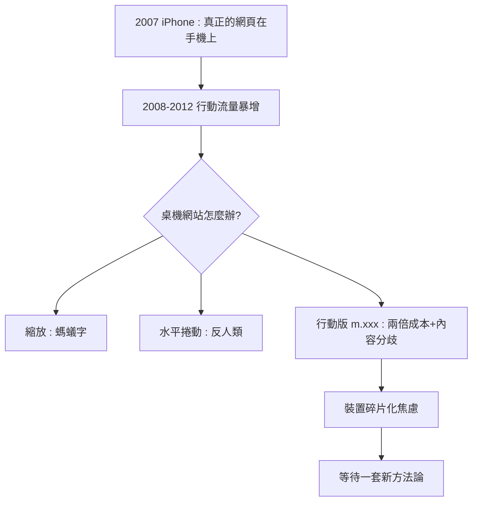

# 智慧型手機爆發與行動網頁的混亂

## 2007 年 1 月 9 日：世界被握進手心

2007 年 1 月 9 日，史帝夫·賈伯斯在 Macworld 發表 iPhone。除了沒有實體鍵盤與多點觸控的轟動之外，網頁設計師應該記住這場發表會的另一個細節：賈伯斯特別展示了 Safari 瀏覽器可以瀏覽「真正的網頁」——不是 WAP 那種閹割版，而是和桌機一樣的完整網站，只是螢幕小得多。

2008 年，App Store 與第一款 Android 手機（HTC Dream）相繼問世。2008 到 2012 年，智慧型手機的全球出貨量從一億多台暴增到七億台以上，行動上網流量呈指數成長。到 2014 年，美國的行動上網流量已超越桌機。人類瀏覽網頁的物理條件，在七年之內徹底翻轉。

## 三個尺寸的災難

對網頁設計而言，這是一場突然降臨的災難。過去十六年，整個行業的預設是：使用者坐在桌機前，螢幕至少 1024 像素寬，用滑鼠精確點擊。而現在的使用者拿著一塊 320 到 480 像素寬的玻璃，用手指戳，站在街上、走在路上。

把桌機網站塞進手機螢幕，有三種當時的常見做法，各有各的災難。第一種是縮放：讓手機瀏覽器把 960 像素寬的頁面縮小塞進 375 像素的螢幕——使用者看到的是螞蟻字，每次閱讀都要雙指放大平移，體驗支離破碎。第二種是水平捲動：保留桌機版面，使用者左右滑動看內容——沒有人喜歡。第三種是另建行動版網站（m.xxx.com）：用伺服器偵測 User-Agent，把使用者導向一份簡化的 WAP 風格頁面——這是當時的主流方案。

行動版網站路線的問題是雙倍的維護成本（兩套內容、兩套程式碼）與災難性的內容分歧（行動版往往被閹割成殘缺版，企業資訊在手機上消失），而且裝置規格碎片化得驚人：iPhone、各種解析度的 Android、平板、小筆電——你要做多少個版本才夠？2010 年前後，業界瀰漫著一種焦慮：裝置只會越來越多，難道要為每一種螢幕都做一個網站？

## 焦慮中的思想脈絡

值得注意的是，解方的思想材料其實已經存在。CSS 2.1 的媒體類型（media types）可以區分螢幕與列印；禪意花園時代確立的「內容與呈現分離」原則意味著，同一份 HTML 理論上可以有多種呈現；流體版面（fluid layout）的技術（百分比寬度）早在表格時代就被摸索過。缺少的是一個把這些零散技術組織成一套完整方法論的人。

2010 年 5 月 25 日，波士頓的獨立設計師伊桑·馬科特（Ethan Marcotte）在 A List Apart 上發表了〈Responsive Web Design〉一文。這篇文章成為行動時代網頁設計的憲法。下一節，我們來看它說了什麼。

人類上網的物理位置變了，設計的法則必須跟著變。而新法則的名字，叫做響應式。
